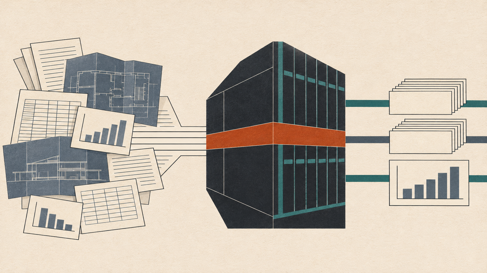

# Arkive RAG



Arkive RAG turns a curated folder of team reference documents (`.pdf`, `.docx`, `.pptx`, `.md`) into one portable, read-only knowledge file (`*.arkive.db`). AI assistants query that file to answer questions with citations and to draft new deliverables that follow the team's past work.

A team uses one snapshot for two jobs:

- **Grounded Q&A with citations.** The assistant finds exact numbers, filenames, table rows, and chart values, and cites the document, section, and page they came from.
- **Grounded drafting from past work.** The assistant receives the closest past examples of the same kind of deliverable, the reviewer lessons that apply to it, and a marker on each passage showing whether it is standard company wording or a clause from one project.

## At a glance

- **No data preparation.** Put the documents in any folder layout. Tagging, renaming, and reformatting are not needed. Optional plain-English `AGENTS.md` notes tell Arkive how the collection fits together.
- **Local, read-only serving.** The server reads the knowledge file on your machine and makes no generative AI calls. Ten of its eleven tools work fully offline, and only `search` needs an OpenAI key, to embed the query. `prepare_draft` ranks past work by keywords when no key is set. When a key is set, it also sends the project inputs to OpenAI for embedding.
- **Capped build spend.** `--max-cost` stops new paid model calls once the estimated spend reaches your limit.
- **Private data stays out of Git.** Keep client documents and `*.arkive.db` files in a private store. The repository's `.gitignore` excludes snapshots and private evaluation packs.

## Quickstart

You need Python `3.14`, [uv](https://docs.astral.sh/uv/), LibreOffice (`soffice`, to read `.docx` and `.pptx` files), and an `OPENAI_API_KEY`. Arkive loads the key from `.env` in the working directory when it is not set.

The commands below build the tracked fictional collection `evals/example_corpora/coastal-survey-projects` (nine files from three survey projects). Keep build outputs outside the corpus folder.

```sh
uv sync --locked

# Compile the folder into one snapshot file (stops new paid calls at about USD 2)
uv run --locked arkive-rag build evals/example_corpora/coastal-survey-projects \
  -o /tmp/arkive-examples/coastal-survey-projects.arkive.db \
  --cache /tmp/arkive-examples/coastal-survey-projects.cache.db \
  --max-cost 2

# Show the filters, document types, version families, and reviewer lessons Arkive found
uv run --locked arkive-rag inspect /tmp/arkive-examples/coastal-survey-projects.arkive.db

# Exact text lookup (offline)
uv run --locked arkive-rag grep /tmp/arkive-examples/coastal-survey-projects.arkive.db \
  "oskary_pit_volume_2026.csv"

# Meaning-based search (needs OPENAI_API_KEY)
uv run --locked arkive-rag search /tmp/arkive-examples/coastal-survey-projects.arkive.db \
  "minimum depth in the dredged channel"

# Serve the snapshot to an MCP-capable AI assistant (stdio by default)
uv run --locked arkive-rag serve /tmp/arkive-examples/coastal-survey-projects.arkive.db
```

`search` and `grep` also take `--filter FACET=VALUE`. Arkive infers the facet names from each collection, so read them from the `inspect` output first.

## Documentation

**Guides** explain the product in plain language:

- [What Arkive does and how a team uses it](docs/overview.md)
- [How folders become searchable knowledge](docs/how-it-works.md)
- [Data boundaries, security, and cost](docs/security-privacy-and-cost.md)
- [Evidence, benchmarks, and known limits](docs/results-and-limits.md)

**Technical appendices and reference** hold the engineering detail:

- [Appendix A: Parsing, induction, and build pipeline](docs/appendices/build-and-parsing.md)
- [Appendix B: MCP tools, drafting packet, and cost scaling](docs/appendices/mcp-tools-and-drafting.md)
- [Appendix C: Evaluation harness and full benchmark tables](docs/appendices/evaluation-benchmarks.md)
- [Architecture and verification reference](docs/architecture.md)

The [documentation hub](docs/README.md) lists every diagram. Contributor instructions for agents start at [`AGENTS.md`](AGENTS.md).
