# Arkive RAG documentation

Arkive RAG turns a folder of PDF (`.pdf`), Word (`.docx`), PowerPoint (`.pptx`), Excel (`.xlsx`), HTML (`.html`, `.htm`) and Markdown (`.md`) reference documents into one portable, read-only knowledge file. AI assistants connect to that file through a local server to answer questions with citations and to draft new work from past examples.

[Open the interactive diagram](assets/system-overview.html)

## Guides

Start here if you are deciding whether to use Arkive, running it for a team, or reading its results.

| Guide | Read it to learn |
| --- | --- |
| [Arkive overview and team workflows](overview.md) | Why a raw folder is hard for an assistant to use, how a team prepares a collection, the two everyday workflows, and a worked example. |
| [Building and serving a snapshot](how-it-works.md) | What the build does to each document, and what the server lets an assistant do. |
| [Data boundaries, security, and cost](security-privacy-and-cost.md) | What is sent to OpenAI and when, the file and network safeguards, spending limits, and measured costs. |
| [Test results and known limits](results-and-limits.md) | How Arkive was tested, what the tests found, and where Arkive does not help. |

## Reference

These pages give exact limits, settings, full result tables and the maintainer specification.

| Document | Covers |
| --- | --- |
| [Appendix A: Build reference](appendices/build-and-parsing.md) | How each file format is read, how the collection is organised, size limits, caching, what the knowledge file stores, model calls during a build, and a worked example. |
| [Appendix B: Server tools and drafting reference](appendices/mcp-tools-and-drafting.md) | Every assistant tool and its limits, how search ranks results, how the drafting packet is assembled, model prices, and how cost grows. |
| [Appendix C: Evaluation method and full results](appendices/evaluation-benchmarks.md) | The test collections, the four kinds of test, every result for the current and previous versions, and the commands to rerun the tests tracked in this repository. Some results come from collections and runs kept outside Git, which the appendix names. |
| [Architecture and verification reference](architecture.md) | The authoritative specification for maintainers: code modules, stored data and its checks, error handling, and the repository's verification commands. |

## Diagrams

Each diagram has an interactive page and an SVG copy for embedding:

- [System overview](assets/system-overview.html) ([SVG](assets/system-overview.svg))
- [Team workflow](assets/team-workflow.html) ([SVG](assets/team-workflow.svg))
- [Data and trust boundaries](assets/data-and-trust-boundaries.html) ([SVG](assets/data-and-trust-boundaries.svg))
- [Previous-version benchmark highlights](assets/benchmark-highlights.html) ([SVG](assets/benchmark-highlights.svg))
- [Build pipeline](assets/build-pipeline.html) ([SVG](assets/build-pipeline.svg))
- [Server tools and drafting packet](assets/mcp-serving-and-drafting.html) ([SVG](assets/mcp-serving-and-drafting.svg))
- [Evaluation harness](assets/evaluation-harness.html) ([SVG](assets/evaluation-harness.svg))

Three illustrations show the main ideas: [a folder becoming one knowledge file](assets/arkive-concept-hero.png), [the two workflows](assets/mcp-workflows-concept.png), and [the data boundary](assets/privacy-vault-concept.png).

## Example data

Every example, document ID, excerpt and result table in these pages comes from fictional documents. Four collections are tracked in `evals/example_corpora/`. Three synthetic stress collections, described in [Appendix C](appendices/evaluation-benchmarks.md#test-collections), are kept outside Git. The repository holds no client documents, personal data or private benchmark results.
