# Appendix A: Build reference

This appendix gives the exact steps, limits and caching rules of `arkive-rag build`. [Building and serving a snapshot](../how-it-works.md) is the plain-language summary. Maintainers will find the authoritative specification, with the code that implements each step, in the architecture reference under [Reading](../architecture.md#reading), [Induction](../architecture.md#induction) and [Snapshot file](../architecture.md#snapshot-file).

The build turns a folder of PDF (`.pdf`), Word (`.docx`), PowerPoint (`.pptx`), Excel (`.xlsx`), HTML (`.html`, `.htm`) and Markdown (`.md`) files into one read-only SQLite file, the snapshot (`*.arkive.db`). It assumes no folder hierarchy, vocabulary or heading convention: a flat folder of Word and PDF files goes through the same steps as a 126-file archive spread over many clients. The build runs in three passes:

1. **Reading** each document on its own.
2. **Organising** the whole collection: filters, document types, versions, lessons, glossary and guide. The architecture reference calls this pass induction.
3. **Storing** the result: final IDs, search vectors and the snapshot file.



[Open the interactive diagram](../assets/build-pipeline.html)

## Reading each document

Reading runs on several files at once (four by default, set with `--max-concurrency`). The result for a file depends only on its bytes and format, so cached results stay valid when other files are added, moved or removed.

### Allowed files, document IDs and dates

The build walks the folder in sorted path order and hashes each file's bytes. Before any model call, it stops on a symbolic link or on any file whose extension is not in the list above, including legacy `.doc`, `.ppt` and `.xls` files. Files and folders whose names start with `.` are skipped.

- **Document IDs.** Each document's ID is derived from its path inside the folder, as `doc_` and ten hexadecimal digits. For example, `q102-oskary-quarry/q102-technical-memorandum.pdf` in `coastal-survey-projects` becomes `doc_cc01ac49e1`. Adding or moving another file never changes an existing document's ID. Sections and chunks get IDs built on the document ID, such as `doc_cc01ac49e1_sec_001`.
- **Document dates.** A date printed in the document wins. When a document prints no date, Arkive uses the creation or modification date stored in the PDF or Office file, and records that the date came from file metadata. In the flat `acoustic-consultancy-files` collection, which has no printed dates and no folders, `corvane-depot-night-noise-report.pdf` gets the metadata date 2025-06-30.
- **`AGENTS.md` notes.** Every `AGENTS.md` file in the folder is a curator note. It is read directly without a model call, guides how the collection is organised, and is returned with the collection guide and in drafting packets. The generated guide, glossary and reviewer lessons never cite a note.

### Word, PowerPoint and PDF files

Word and PowerPoint files are converted to PDF in an isolated, headless LibreOffice. Checkboxes, floating text boxes, embedded charts and slide layouts then go through the same page steps as native PDFs.

Before LibreOffice or any parser sees a Word, PowerPoint or Excel file, Arkive unpacks the file's archive in 64 KiB steps and refuses it when:

- it is not a readable zip archive;
- it declares more than 5,000 entries;
- an entry is encrypted, or its unpacked size or checksum differs from what the archive declares;
- it would unpack to more than 100,000,000 bytes.

A Word file is converted from a copy with its tracked changes accepted: deleted text is removed and inserted text kept. Without this step, LibreOffice draws a deletion and its replacement as one run of text. The original file still supplies the document's hash and metadata date.

Arkive then adds content from the file's own structure to the page that holds the marked text, as quoted `[Annotation — ...]` blocks:

- each Word tracked insertion and deletion, with author and date, and each Word comment;
- each shown PowerPoint slide's speaker notes and comments.

A PowerPoint slide's native chart becomes a table under a `Chart: <title>` line. Hidden slides are skipped, as LibreOffice skips them. Annotations are stored as their own search chunks. A fact the document states about itself never counts when its quote appears only in an annotation or a chart description.

Each PDF page is rendered at twice its size as a WebP image, with its longest side capped at 4,096 pixels, and its text layer is extracted. With `--cache`, rendered pages and metadata dates are stored by the hash of the source file, so rebuilding an unchanged folder renders no pages and opens neither LibreOffice nor the PDF renderer.

### Excel workbooks and HTML pages

Excel and HTML files have no pages. Arkive reads them from memory with Docling's spreadsheet and HTML readers. The build installs only those two Docling readers, so no machine-learning framework such as PyTorch is installed, and serving never loads Docling.

- **Workbooks.** Each worksheet becomes a top-level heading, and each block of data a `Range A2:D5` line followed by a table. A header merged over several rows is flattened into one row (`Group — Column (Unit)`). A formula saved without a computed value shows the formula itself (`=B4+C4`). Cell notes and threaded comments, with their replies, follow the sheet's tables as annotations. A workbook with more than 250,000 populated cells is refused, so it is never silently cut short.
- **HTML pages.** Arkive fetches no image, remote or local, and does not render the page. Text before the first heading stays body text. Headings, paragraphs, lists, code blocks and tables follow in document order. Images and their alt text are left out.

Their text is split into sections the same way as a Markdown file, and each section counts as page 1. They have no page images to view.

### Page transcription and checks

For each rendered page, `gpt-6.1-sol` at low reasoning effort receives the page image, the page's text layer, and the last 1,200 characters transcribed from the previous page. It returns headings, paragraphs, tables and lists, plus separate descriptions of charts, maps and diagrams. The request asks the model to transcribe values that exist only inside a chart image into that description.

Two checks guard each page:

1. **Numbers and filenames survive.** Arkive collects numbers, measurements and data filenames from the page's text layer and checks that the transcript keeps them. When the transcript misses any filename, or misses more than a small share of the numbers, Arkive transcribes the page once more at high effort and names the missing values in the request. [Reading](../architecture.md#reading) gives the exact thresholds. If the retry still misses a filename or too many numbers, the build stops with an error that names the file, page and missing values. When a retry changes the end of a page's transcript, the next page is transcribed again, and this stops at the first page whose ending is unchanged.
2. **Sections and tables join across pages.** Arkive builds sections from the headings, each with its heading path and page range. A paragraph or table that continues across a page break is joined to its first part. A table row cut in the middle of a cell is rejoined cell by cell, and each row remembers the pages it came from.

A section longer than 32,000 characters is split into consecutive sections with the same heading path, cut between paragraphs, tables and other blocks. A single block too large for one section is sliced: a table on row boundaries with its header rows repeated, a chart description or annotation at line breaks with its title repeated on each slice, and a code block closed at the end of one slice and reopened at the start of the next. Each section is then cut into search chunks of up to 6,000 characters, of five kinds: prose, table, chart description, annotation and curator note. The section itself stays whole for reading.

### Document records

`gpt-6.1-sol` at low effort reads each document's sections, in batches for a long document, and records:

- its title, printed date, proposed document type and summary;
- the facts it states about itself, such as its reference, client, site, status, author and instruments;
- the terms it uses.

Every fact and term must come with a quote. Arkive looks for each quote in the document's sections, ignoring differences in case, dashes, whitespace and Markdown formatting. A quote it cannot find gets one retry that names it. If it is still missing, the item is dropped and counted in the build report. Each fact whose quote is found is stored with the section that holds the quote. A quote found only in an annotation or chart description does not count.

## Organising the collection

This pass runs once over the whole collection, using the model's record of each document, the folder paths and the `AGENTS.md` notes. Every prompt in this pass stays within 90,000 characters (about 30,000 tokens), so a large archive never overflows the model's context window.

1. **Filters and document types.** Document digests go to the model in batches of up to 44,000 characters. The model proposes up to 6 filters suited to the collection and gives each document a type. A filter either follows the folder structure, such as one folder per project, or comes from what the documents say. A review is marked as feedback on the types it reviews and keeps its own type. One more request merges filters and values that mean the same thing across batches, keeping at most 6 filters. Another maps every proposed type label to one canonical type. The number of types is not capped.
2. **Assigning filter values.** Values of a folder-based filter come from folder names. For a text-based filter, `gpt-6-luna` decides each document's value from its record and outline. Values no document uses, and filters with fewer than two used values, are removed and listed in the build report.
3. **Version groups.** Arkive pairs documents that share many identical four-word sequences, or whose titles and filenames overlap within one type. Text shared by more than 12 documents is ignored, because it is boilerplate. Pairs join documents into groups of at most 16. A weaker pair that would make a group larger is dropped and counted in the build report. For each group, one `gpt-6.1-sol` request splits the documents into sets of versions of one deliverable. It names a latest version only when one clearly replaces the others, and a file's saved date never proves that. The latest version is marked `latest` and the others `superseded`. When the order is unclear, every version is marked `unordered`.
4. **Reviewer lessons.** For each feedback document, `gpt-6.1-sol` extracts lessons for future work, each with a quote. Arkive finds each quote in a section, and `gpt-6-luna` confirms the section's lessons in one request. Unconfirmed lessons are dropped and counted in the build report.
5. **Glossary.** The terms each document uses become glossary entries with cited meanings. `gpt-6-luna` checks each proposed definition against its cited evidence, and an unsupported definition is left empty. An empty definition means only that the cited evidence did not establish one. The collection may still define the term elsewhere.
6. **Standard wording.** Without a model call, Arkive compares the paragraphs, list items and table header rows of every document, and groups those that appear in more than one document. It keeps a sample of the matching text from each document that holds it.
7. **Collection guide.** `gpt-6.1-sol` writes a 4,000 to 8,000 character overview of the collection from its documents, filters, types, glossary and notes. The hard limit is 16,000 characters. Arkive checks that every citation in the guide points to a real section of the document it names.

## Storing the snapshot

Each section and chunk gets its final ID. Each chunk also gets a breadcrumb line that names its filter values, document title, pages and heading path. `text-embedding-3-large` computes a 1,536-dimension vector for each chunk from its breadcrumb and text, and each vector is normalised to unit length.

Arkive writes the snapshot to a temporary file next to the output, readable only by its owner. It builds the keyword search index, which weights chunk text above breadcrumbs, and runs SQLite's integrity checks. It then renames the temporary file over the output in one step, so a failed build leaves any earlier snapshot untouched. Replacing an existing snapshot keeps that file's permissions. A snapshot in an earlier format (the current format is schema `7.0`) cannot be opened, so rebuild it from its folder.

### Snapshot contents

A snapshot holds:

- the collection's metadata and guide, and the `AGENTS.md` notes word for word;
- one record per source file, with its filter values, type, date and version group;
- the facts each document states about itself, each linked to its section;
- every table in every section, stored row by row with a keyword index;
- the glossary, the reviewer lessons and the groups of standard wording;
- every section, every rendered page, and every chunk with its vector and keyword index.

[Snapshot file](../architecture.md#snapshot-file) in the architecture reference lists every table and column.

### Model calls during a build

| Step | Model | Calls |
| --- | --- | --- |
| Page transcription | `gpt-6.1-sol`, low effort (high on a retry) | One per rendered page. |
| Recording each document | `gpt-6.1-sol`, low effort | One per batch of a document's sections, plus one to merge the batches of a long document. |
| Filters, type merging, version groups, glossary, guide | `gpt-6.1-sol`, medium effort | Filters once per batch of digests; filter merging, type merging and the guide once per collection; one per version group; the glossary once per batch of terms. |
| Reviewer lessons | `gpt-6.1-sol`, low effort | One per batch of a feedback document's sections. |
| Text-based filter values and support checks | `gpt-6-luna`, through OpenAI's Decisions API | One per document for text-based filters, one per glossary definition, and one per section that holds reviewer lessons. |
| Chunk vectors | `text-embedding-3-large` | In batches over the whole collection. |

With `--cache`, every model response is stored under a hash of its inputs. Rebuilding an unchanged folder makes no paid calls. Adding a file reads only that file. The organising pass is requested again because the collection changed, but any request whose inputs are identical is still answered from the cache.

`build` prints the paid calls, tokens and estimated cost, then the build report. The report counts what the checks removed or could not confirm:

- facts and terms dropped because their quote was not found (`discarded_unlocated_quotes`);
- definitions and lessons the support checks did not confirm (`unsupported_definitions`, `dropped_feedback_lessons`);
- yes/no questions the model refused (`judge_refusals`);
- removed filter values and filters (`pruned_facet_values`, `pruned_facets`);
- `AGENTS.md` notes too long for a prompt to show in full (`truncated_curator_notes`);
- version pairs dropped to keep groups small (`dropped_version_edges`).

## Worked example

The file `archive/m2409-northbray-askern-viaduct/m2409-installation-and-baseline-report.docx`, in the 126-file fictional `structural-monitoring-consultancy` collection, shows what the three passes produce. The figures come from the metered first build of the collection on the current version.

1. **Identity and rendering.** The document's ID is `doc_4957546a24`. LibreOffice converts the Word file to PDF, and all 52 pages are rendered.
2. **Transcription and sections.** Transcription and joining produce 86 sections, `doc_4957546a24_sec_001` to `doc_4957546a24_sec_086`, keeping the document-control tables and the instrument schedules that run over several pages.
3. **Organisation.** Across the collection, the build creates 28 document types, 30 confirmed reviewer lessons and a 10,395-character cited guide. For this document it records:
   - type: `Installation and baseline report`
   - date: `14 October 2024`
   - version status: `sole` (the document has no other versions)
   - filter values: `issue_status: issued`, `job_cohort: archive`, `project: M2409 Askern Viaduct`, `sensing_technology: fibre_bragg_grating`
   - 17 confirmed facts, including `reference: MI-IR-2409`, `status: Issue 1, final` and `instruments: Prisma FI-4 interrogator, serial PF4-1876`
   - 61 stored tables

   Filter names come from the organising pass, so another build of the same collection can name them differently. [Appendix C](evaluation-benchmarks.md#version-groups-and-filter-coverage) compares three builds.

   In the same folder, the calibration sheet `prisma-fi-4-calibration-pf4-1876.md` (`doc_a971f575a6`) is byte-for-byte identical to a copy in the `m2505-halverton-greyscar-spillway` folder (`doc_fed78f012b`). The build groups them as versions of one document and marks `doc_a971f575a6` as superseded by `doc_fed78f012b`.
4. **A stored chunk.** The first chunk of the report, a table on page 1, is indexed and embedded as:

```text
[job_cohort: archive | sensing_technology: fibre_bragg_grating | issue_status: issued | project: M2409 Askern Viaduct | Doc: Askern Viaduct: fibre Bragg grating installation and baseline report (pp. 1-1) | Section: Askern Viaduct: fibre Bragg grating installation and baseline report]
| Item | Detail |
| --- | --- |
| Our ref | MI-IR-2409 |
| Client | Northbray Rail Infrastructure |
| Client contact | Mr Jarrow Keld |
| Author | Maren Lisk |
...
```

5. **A linked reviewer lesson.** From the unlabelled QA register `active/m2505-halverton-greyscar-spillway/qa-disposition-register.docx`, the build extracts and confirms seven lessons for `Installation and baseline report`, including: *"Apply strain-free reference grating temperature compensation before reporting wavelength shifts as strain, and state this step in the method."*

Rebuilding the same collection with `--cache` and no changes made 0 paid calls ($0.0000). On the previous version, adding a 127th file, `a00-new-intake/a00-scoping-note.md`, at the start of the folder tree left all 126 existing document IDs unchanged.
