# Appendix C: Evaluation harness and full benchmark tables

> Technical appendix. For the plain-language summary, read [Evidence, benchmarks, and known limits](../results-and-limits.md). The authoritative specification is in [Evaluation](../architecture.md#evaluation), [Example corpora](../architecture.md#example-corpora), and [OpenCode check](../architecture.md#opencode-check).

The evaluation harness in `evals/` tests whether a compiled snapshot beats giving the same model direct file tools over the raw corpus, and compares Arkive with a control that pastes human-selected full exemplars into the prompt. Every result below comes from the four public fictional collections in `evals/example_corpora/`.



[Open the interactive diagram](../assets/evaluation-harness.html)

## The four public fictional collections

Each collection has a matching `arkive-eval-pack/3` pack in `evals/example_packs/`, and each stresses a different corpus shape.

| Collection | Files and formats | Structural traps tested |
| --- | --- | --- |
| `coastal-survey-projects` | 9 files (`.md`, `.pdf`, `AGENTS.md`) across 3 project folders | Proposals against technical memoranda, reviewer feedback lessons, domain acronyms (`MBES`), cross-type bleed between proposals and memos. |
| `creator-campaigns` | 9 files (`.md`, `.pptx`, `AGENTS.md`) across 2 creators and 4 campaigns | Campaign briefs, review notes, a PowerPoint launch deck, policy clauses borrowed across creators. |
| `acoustic-consultancy-files` | 9 files (`.docx`, `.pdf`) in one flat folder, no `AGENTS.md` | Dates only from embedded file metadata, old letter and newer numbered report layouts, shared caveats that differ by one instrument name, chart-only values, a one-project data-retention policy. |
| `structural-monitoring-consultancy` | 126 files (110 `.md` including 2 `AGENTS.md`, 10 `.docx`, 6 `.pdf`; 110 rendered pages) | Scale: 17 authored types (28 induced), a 52-page Word baseline report, superseded draft families, a byte-identical duplicate, unlabelled QA disposition registers, method distractors (vibrating-wire against fibre Bragg grating), and a vector-only PDF chart value (`-142`). |

## Evaluation layers

Before it creates `--out`, opens `--cache`, or calls OpenAI, `python -m evals.run` runs a preflight that checks the pack schema, the snapshot `corpus_fingerprint`, facet filters, Q&A anchor evidence sizes, holdout leak guards, LibreOffice availability, and that output paths do not overlap inputs. Outputs are written atomically with owner-only (`0600`) permissions.

1. **Layer 1, retrieval ablation (`evals/ablation.py`).** Compares `bm25_only`, `dense_only`, `hybrid_rrf`, and `served_search` (the search agents get, hiding superseded drafts and capping each version family at 3 chunks) with one shared query embedding per case. Cases cover exact identifiers, paraphrases, visual-only chart and map questions, repaired font ligatures, and disambiguation with facet `filters`. Reports `Completion@1/3/5` and `CompletionMRR@5`.
2. **Layer 2, grounded Q&A (`evals/agents.py`).** Runs the same `gpt-6.1-sol` agent conversation (OpenAI Agents SDK through `OpenAIGateway.converse`) on lookup, multi-document, aggregation, conflict, abstention, and vocabulary cases under two tool sets: raw file tools (`list_corpus_files`, `grep_raw_text`, `read_raw_pages`, `view_raw_page_image`) and the eleven Arkive MCP tools. Completed answers get phrase coverage and a blinded `gpt-6.1-sol` judge that reads the reference facts and the snapshot text of the anchored pages and labels every material claim `supported`, `contradicted`, or `unverifiable`. Token usage, each tool call, and latency are recorded.
3. **Layer 3, holdout drafting (`evals/drafting.py`).** Builds an isolated `holdout.arkive.db` without the target. Guards exclude files whose path holds a held-out marker and files byte-identical to the reference. The guards infer nothing from folders and do not scan content, so the pack author must exclude changed copies and documents that restate held-out facts. When the holdout names exemplar documents, one `prepare_draft` call first records how many of them the packet surfaces. Each of `--drafts` rounds runs up to five arms, all drafting from project run notes:
   - `zero_shot`: no tools;
   - `chunk_search`: plain chunk search only;
   - `raw_files`: file tools over the included files;
   - `arkive_mcp`: the eleven Arkive tools, centred on `prepare_draft`;
   - `exemplars_in_context`: the holdout's named exemplars pasted into the prompt under the frozen `EXEMPLAR_DRAFTING_RULES`. This is the control, and it runs only when the holdout names exemplars.

   Each completed draft gets deterministic rubric checks, two per-document lexical 4-gram measures (house-text recall, and copied-text contamination from included documents the reference does not carry), and one blinded `gpt-6.1-sol` comparison per round that receives `holdout.instructions`, `run_notes`, and the reference.
4. **Live OpenCode check (`evals/opencode_check/`).** Runs ten scenarios in fresh Docker containers with OpenCode 2.3.0 (`openai/gpt-6.1-sol`), snapshots mounted read-only, and only the Arkive MCP tools enabled. A scenario fails if OpenCode calls a non-Arkive tool or truncates an Arkive result.

## Benchmark results

All runs used `gpt-6.1-sol`, `gpt-6-luna`, and `text-embedding-3-large` on schema `6.0` snapshots of the tracked collections. Layer 3 runs used 5 rounds per arm.

### Grounded Q&A at 126-file scale (Layer 2)

`structural-monitoring-consultancy`, 8 Q&A cases across lookup, multi-document, aggregation, conflict, abstention, and vocabulary:

| Arm | Phrase coverage | Accuracy (1-5) | Citations (1-5) | Completeness (1-5) | Contradicted claims | Unverifiable claims | Input tokens | Tool calls | Elapsed |
| --- | --- | --- | --- | --- | --- | --- | --- | --- | --- |
| `raw_files` | 6/8 | 4.75 | 4.62 | 4.62 | 0 | 6 | 134,043 | 36 | 100 s |
| `arkive_mcp` | **8/8** | **4.88** | **5.00** | **4.75** | **0** | **1** | **77,215** (-42%) | **21** | **85 s** |

Raw-file extraction took a further 29.2 s up front. On the two conflict cases, where superseded drafts disagree with issued documents, `raw_files` reached 0/2 phrase coverage and `arkive_mcp` 2/2.

Layer 1 on the same snapshot (10 cases, top 5): `hybrid_rrf` reached 60% `Completion@5`, `served_search` 50%, `bm25_only` 50%, and `dense_only` 40%. All four arms reached 100% `Completion@3` on the vector-only PDF chart case (`visual_only`).

### Holdout drafting across all four collections (Layer 3)

Medians across 5 completed rounds. The blind judge scores Structure, Rigor, Limitations, Discipline, and Effort saved (`S/R/L/D/E`) from 1 to 10. Token counts are 5-round totals.

| Collection and holdout | Arm | Selection (packet / cand.) | House recall | Contamination | Judge medians (`S/R/L/D/E`) | 1st-place wins | Input tokens (5 rounds) |
| --- | --- | --- | --- | --- | --- | --- | --- |
| **Structural (126 docs)** `brackenford-footbridge-proposal` | `arkive_mcp` | 2/5 · 5/5 | **0.984** | **0.0000** | **9 / 9 / 9 / 10 / 9** | **5/5** | 221,802 |
| | `raw_files` | — | 0.810 | 0.0000 | 8 / 9 / 9 / 8 / 8 | 0/5 | 212,379 |
| | `exemplars_in_context` | control | 0.971 | 0.0000 | 9 / 8 / 8 / 10 / 8 | 0/5 | 30,175 |
| **Structural (126 docs)** `tallow-cross-fbg-installation-report` (52-page exemplar) | `arkive_mcp` | 2/3 · 3/3 (fb 1/1) | **0.656** | **0.0000** | 7 / 8 / 8 / 9 / 7 | 0/5 | **179,051** |
| | `raw_files` | — | 0.377 | 0.0000 | 8 / 8 / 8 / 9 / 7 | 0/5 | 287,143 |
| | `exemplars_in_context` | control | 0.977 | 0.0226 | **9 / 9 / 9 / 8 / 9** | **5/5** | 540,990 |
| **Acoustic (flat folder)** `corvane-depot-night-noise-report` | `arkive_mcp` | 3/3 · 3/3 | 0.343 | **0.0069** | **9 / 8 / 9 / 10 / 9** | **5/5** | **47,880** |
| | `raw_files` | — | 0.292 | 0.0000 | 6 / 8 / 9 / 10 / 7 | 0/5 | 112,328 |
| | `exemplars_in_context` | control | 1.000 | 0.0757 | 8 / 6 / 5 / 4 / 6 | 0/5 | 17,340 |
| **Acoustic (flat folder)** `pellow-mill-facade-report` | `arkive_mcp` | 3/3 · 3/3 | 0.346 | **0.0000** | **8 / 9 / 7 / 10 / 8** | **3/5** | 48,405 |
| | `raw_files` | — | 0.309 | 0.0000 | 8 / 8 / 7 / 10 / 8 | 1/5 | 28,760 |
| | `exemplars_in_context` | control | 0.346 | 0.0000 | 8 / 8 / 7 / 10 / 8 | 1/5 | 16,980 |
| **Coastal (9 docs)** `fennick-canal-proposal` | `arkive_mcp` | 2/2 · 2/2 | **1.000** | **0.0000** | **9 / 10 / 10 / 10 / 9** | **2/5** | 38,815 |
| | `raw_files` | — | 1.000 | 0.0000 | 9 / 10 / 10 / 10 / 8 | 0/5 | 26,000 |
| | `exemplars_in_context` | control | 1.000 | 0.0000 | 9 / 10 / 9 / 10 / 9 | 2/5 | 8,305 |
| **Coastal (9 docs)** `fennick-canal-technical-memorandum` | `arkive_mcp` | 2/2 · 2/2 (fb 2/2) | n/a (0 house units) | **0.0000** | **9 / 9 / 10 / 10 / 9** | 1/5 | 32,890 |
| | `raw_files` | — | n/a | 0.0000 | 9 / 10 / 10 / 10 / 9 | **4/5** | 19,640 |
| | `exemplars_in_context` | control | n/a | 0.0000 | 9 / 8 / 8 / 8 / 8 | 0/5 | 10,905 |
| **Creator (9 docs)** `kettlecraft-winter-campaign-brief` | `arkive_mcp` | 3/3 · 3/3 (fb 2/2) | **1.000** | 0.0526 | **10 / 9 / 9 / 9 / 9** | 0/5 | 36,040 |
| | `raw_files` | — | 1.000 | 0.0470 | 10 / 9 / 9 / 9 / 9 | 1/5 | 20,020 |
| | `exemplars_in_context` | control | 1.000 | 0.0493 | 10 / 9 / 9 / 9 / 9 | 1/5 | 11,285 |

On `brackenford-footbridge-proposal`, median contamination was `0.0000` with one outlier round at `0.1118`. On `kettlecraft-winter-campaign-brief`, `chunk_search` won 3 of 5 rounds in the 9-document run, while `arkive_mcp` matched the control on all five judge medians (`10/9/9/9/9`).

### Live OpenCode 2.3.0 container check

Three snapshots were mounted at once (`coastal-survey-projects`, `creator-campaigns`, and the 126-file `structural-monitoring-consultancy`) in OpenCode 2.3.0 (`openai/gpt-6.1-sol`):

- **Scenarios passed:** 10 of 10 (`topic-and-facet-discovery`, `glossary-defined-term`, `glossary-undefined-term`, `glossary-two-senses`, `filtered-listing-discovered-facet`, `invalid-filter-recovery`, `grep-exact-number`, `chart-value-view-page`, `draft-from-packet`, `cross-topic-question`).
- **Tool discipline:** no non-Arkive tool calls and no truncated MCP results.
- **Cost reported by OpenCode:** at least $0.1134 across all 10 scenarios, 12 to 16 seconds each.

## Findings and limits

1. **Provenance prevents policy leaks.** On `corvane-depot-night-noise-report`, `exemplars_in_context` copied another project's six-year audio retention policy, which dropped its Discipline median to 4 (contamination `0.0757`). `prepare_draft` reports family counts and dates for each section, and `arkive_mcp` avoided the borrowed policy (Discipline 10, contamination `0.0069`), won 5 of 5 rounds, and used 57% fewer input tokens than `raw_files`.
2. **The advantage appears at scale.** On 9-file collections, MCP tool schemas add a fixed per-turn overhead, so pasting two or three short Markdown files uses fewer tokens. On the 126-file archive, Arkive beat `raw_files` on Q&A accuracy with 42% fewer tokens, and cut input tokens on the 52-page report holdout by 38% against `raw_files` and 67% against `exemplars_in_context`.
3. **Gap on very long multi-section reports.** On `tallow-cross-fbg-installation-report`, `exemplars_in_context` won 5 of 5 rounds (`9/9/9/8/9` against Arkive's `7/8/8/9/7`) and passed the `house_temperature_compensation` rubric check 5 of 5 times against Arkive's 0 of 5. Pasting the whole 52-page Askern Viaduct report exposed every detailed section without follow-up `read_section` calls.
4. **Overlapping facet names.** On the 126-file archive, batched organisation produced two overlapping technology facets, `sensing_technology` and `monitoring_technology`. Both remain valid filters and did not block Q&A or drafting. Canonicalising synonymous facet names across batches would remove the overlap.

## Running an evaluation

```sh
# 1. Build a public example snapshot outside the repository
uv run --locked arkive-rag build evals/example_corpora/coastal-survey-projects \
  -o /tmp/arkive-examples/coastal-survey-projects.arkive.db \
  --cache /tmp/arkive-examples/coastal-survey-projects.cache.db --max-cost 2

# 2. Run layers 1-3 against it
uv run --locked python -m evals.run \
  --pack evals/example_packs/coastal-survey-projects.eval.json \
  --snapshot /tmp/arkive-examples/coastal-survey-projects.arkive.db \
  --corpus evals/example_corpora/coastal-survey-projects \
  --out /tmp/arkive-eval-outputs/coastal-survey-projects \
  --layer all --drafts 3 --max-cost 6

# 3. Run the live Docker OpenCode check across several snapshots
uv run --locked python -m evals.opencode_check \
  /tmp/arkive-examples/coastal-survey-projects.arkive.db \
  /tmp/arkive-examples/creator-campaigns.arkive.db \
  --out /tmp/arkive-opencode-check
```
