# Appendix B: MCP tools, drafting packet, and cost scaling

> Technical appendix. For the plain-language summary, read [How folders become searchable knowledge](../how-it-works.md) and [Data boundaries, security, and cost](../security-privacy-and-cost.md). The authoritative specification is in [Retrieval](../architecture.md#retrieval), [Drafting packet](../architecture.md#drafting-packet), and [MCP server](../architecture.md#mcp-server).

`arkive-rag serve` mounts one or more `.arkive.db` snapshots read-only and exposes ten MCP tools over `stdio` (default) or `streamable-http`. The server makes no generative model calls. It serves local SQLite data, bounded Markdown and WebP payloads, and, when `OPENAI_API_KEY` is set, one query embedding per `search` or `prepare_draft` call.

[Open the interactive diagram](../assets/mcp-serving-and-drafting.html)

## Startup checks and transport safety

`TopicSnapshot.open` opens each snapshot through a percent-encoded read-only SQLite URI (`?mode=ro`) and verifies that:

- `SCHEMA_VERSION == "7.0"` and every required table is present;
- no foreign key dangles and every facet value has its canonical alias;
- `corpus_fingerprint`, every glossary citation, the document roles, version families, feedback lessons, and recurring clusters pass validation;
- the normalised `(N, 1536)` `float32` chunk embedding matrix loads into memory.

`create_mcp_server` in `src/arkive_rag/server.py` registers the tools. With `OPENAI_API_KEY` set, all served snapshots must share one embedding model and dimension, or `serve` refuses to start.

The server starts without `OPENAI_API_KEY`. Nine tools then work unchanged, `prepare_draft` ranks with BM25 alone, and `search` reports that it needs a key (the CLI `grep` is the offline alternative for exact matches). With `--transport streamable-http`, the server binds to `127.0.0.1:8000` by default. It refuses a host outside `LOOPBACK_HOSTS` (`127.0.0.1`, `localhost`, `::1`) unless `--allow-nonlocal` is passed, because the HTTP transport has no built-in authentication.

## The ten tools and their bounds

Every tool returns one compact JSON text block of at most 45,000 bytes and 1,600 lines (`RESPONSE_MAX_BYTES`, `RESPONSE_MAX_LINES` in `snapshot.py`). That limit sits below the size at which MCP clients such as OpenCode truncate tool results, so an agent never silently loses the end of a search result, outline, or drafting packet.

During the MCP initialisation handshake, `INSTRUCTIONS` tells the client to call `list_topics` when topics or facets are unknown, to answer questions with the read tools while citing `doc_id`, `section_id`, and pages and saying so when the corpus does not establish a fact, and to draft by calling `prepare_draft` with the user's full inputs. When the server serves a single topic, `server_instructions` appends the topic slug, its facet names, and up to 20 deliverable types, so the agent can skip a first `list_topics` call.

| Tool | Purpose | Defaults and bounds |
| --- | --- | --- |
| `list_topics` | List served topics with their facets, allowed values, and deliverable types. | First 50 values and types per topic inline, the rest counted; paginated. |
| `get_topic_guide` | Return the cited guide, curator notes, facet definitions, glossary terms, and each deliverable type with its document and feedback counts. | Within 45 KB; omitted items are reported. |
| `list_documents` | Page through documents with dates, deliverable types, version families, and bound facets. | `limit` 50 by default, at most 100 (`MAX_DOCUMENT_PAGE`), fewer when more would not fit; summaries cut to 240 characters (`LIST_SUMMARY_CHARS`). |
| `get_document_outline` | Return a document's section tree (`section_id`, `heading_path`, page span, character count). | Paginated with `offset`. |
| `lookup_glossary` | List glossary terms, or return matching entries with cited senses. A `null` definition means none was established from the cited evidence. | Query at most 1,000 characters; paginated within 45 KB. |
| `grep` | Case-insensitive, NFKC- and dash-normalised substring scan of section Markdown for exact codes, filenames, and numbers. | `max_matches` 12 by default, at most 50; takes `filters`. |
| `search` | Hybrid chunk search (below). | `top_k` 5 by default, at most 50; hides superseded drafts behind their latest version; at most 3 chunks per version family before backfilling. |
| `read_section` | Return full section Markdown with `prev_section_id` and `next_section_id` links. | Paginated with `offset`. |
| `view_page` | Return the rendered `image/webp` page with its visual summary and native text, so a multimodal model can inspect charts, maps, and layouts. | Text fields cut, with counts of what was left out, to fit 45 KB. |
| `prepare_draft` | Assemble one drafting packet for a new deliverable from the user's inputs. | 45,000-byte budget; up to 3 exemplars with outlines, inline sections, lessons, notes, and provenance. |

`list_documents`, `search`, `grep`, and `prepare_draft` accept `filters`, for example `{"job_status": "archived", "sensing_technology": "fibre_bragg_grating"}` on the `structural-monitoring-consultancy` snapshot. Each key is a facet and each value a canonical value or alias. Keys combine with AND. An unknown facet or value returns a structured error that lists the valid options, so the agent can recover in one turn. The CLI `search` and `grep` take the same filters as repeated `--filter FACET=VALUE`.

### Hybrid search

`search` validates filters locally and embeds the query once. It then ranks the top 300 FTS5 BM25 hits and the top 300 exact cosine-similarity hits (`matrix @ query_vector`) and merges them with Reciprocal Rank Fusion, `1 / (60 + rank)` (`RRF_K = 60`). `build_fts5_query` quotes tokens and adjacent phrases, so punctuation and operators in a query never raise FTS5 syntax errors. The result leaves out a superseded draft behind its latest version and shows at most three chunks of one version family before filling the list.

## Inside `prepare_draft`

`prepare_draft(topic, project_inputs, deliverable_type, filters)` selects and packs reference material at request time.

1. **Task-ranked exemplars.** Eligible latest-version deliverables are scored against `project_inputs` by each document's best three chunk matches (hybrid BM25 and cosine with a key, BM25 alone without). Up to 3 exemplars are admitted (`MAX_PACKET_EXEMPLARS`) and up to 8 more are listed as `other_candidates` (`MAX_OTHER_CANDIDATES`).
2. **Related-type backfill.** When fewer than two exemplars of the requested `deliverable_type` exist, a high-relevance document of another type can fill an open slot. Once two or more same-type exemplars are present, a third cross-type document is admitted only when its type shares a content word with the requested type (for example, `Noise assessment letter` for `Noise assessment report`) and it scores at least 0.6 (`CROSS_TYPE_RELEVANCE`) of the top exemplar.
3. **Room for long exemplars.** A 52-page report with 86 sections could fill the packet with its outline alone. Each exemplar's outline is capped at 8,000 bytes (`EXEMPLAR_OUTLINE_MAX_BYTES`), keeping top-level, recurring, input-matched, and boundary rows first and reporting `omitted_outline_sections`. At least 16,000 bytes (`PACKET_MIN_INLINE_BYTES`) are reserved for inline section Markdown when more than one exemplar is kept.
4. **Section priority.** Within the inline budget, whole sections are packed in priority order: input-matched sections, sections holding distinct recurring clusters, then opening and closing sections. Up to 2 `supplemental_sections` (`MAX_SUPPLEMENTAL_SECTIONS`) come from outside the chosen exemplars when they hold rare words of `project_inputs`, such as a specialist biography or a method appendix.
5. **Curator notes and lessons.** Up to 6,000 bytes each of relevant curator notes (`PACKET_NOTES_BYTES`) and verified feedback lessons for the requested type (`PACKET_LESSONS_BYTES`), with `omitted_curator_notes` and `omitted_lessons` counted.
6. **Provenance.** Every section reports its document date, version status, and how many independent version families share its recurring text (`family_recurrence`, whose `corpus_family_count` gives the largest number of families holding any one recurring unit). The packet's `recurring_samples` list the opening words of those recurring passages. Text shared by several families is established house text that the agent can reproduce. A clause from one family may be project-specific, so the agent weighs its scope and, in an interactive session, asks the user when an institutional policy is uncertain. Every fact, number, date, and deliverable of the new work comes from `project_inputs`.

## Hosted models, costs, and scaling

`src/arkive_rag/llm.py` fixes three OpenAI models. Every snapshot records the exact model IDs and reasoning efforts in `corpus_meta.build_settings`. Prices are the standard list prices the cost meter uses, in USD per million tokens.

| Model | Input / cached input / output | Used during `build` | Used during `serve` |
| --- | --- | --- | --- |
| `gpt-6.1-sol` | $2.00 / $0.10 / $10.00 | Page transcription (low effort, high on retry), observation cards, organisation, facet and type canonicalisation, version partition, feedback lessons, glossary, topic guide | Never called by the server |
| `gpt-6-luna` | $0.10 / $0.01 / $0.00 | Decisions API: content-bound facets, glossary and lesson support checks | Never called |
| `text-embedding-3-large` | $0.13 input | Batched chunk embeddings (1,536 dimensions) | One query embedding per `search` or `prepare_draft` call |

Measured on the public fictional corpora:

- **Cold build.** The 126-file `structural-monitoring-consultancy` archive (110 Markdown, 10 `.docx`, and 6 `.pdf` files; 110 rendered pages including a 52-page report; 1,086 chunks; 28 deliverable types; 29 lessons) cost about $1.22 across the build and guide pass. Cold build cost grows mainly with rendered pages.
- **Unchanged cached rebuild.** 0 provider calls and 0 rendered pages: $0.0000.
- **Incremental file.** Adding a 127th Markdown file kept 126 of 126 document IDs, reused every cached render and page transcription, and cost $0.28 for reading the new file and rerunning induction.
- **Runtime tokens.** Because every result is capped and `prepare_draft` returns one packet, the agent's token use grows slowly with archive size. On the 126-file archive, the Arkive arm used 42% fewer input tokens than raw-file tools on Q&A (77,215 against 134,043). On the 52-page installation report holdout it used 179,051 input tokens, 38% fewer than raw files (287,143) and 67% fewer than pasted full exemplars (540,990).

`arkive-rag build` and `python -m evals.run` accept `--max-cost <USD>`. No new provider call starts once the estimated spend reaches the limit. Calls already in flight can finish past it, and the estimate excludes the long-context surcharge.
