# Evaluation harness and benchmark results

Arkive's evaluation harness (`evals/`) tests whether a compiled snapshot beats giving the same model direct file tools over the raw corpus directory, and compares Arkive against a human-selected full-context control. All benchmark results below come exclusively from the four public fictional collections tracked in `evals/example_corpora/`.



[Open interactive HTML diagram](assets/evaluation-harness.html)

## The four public fictional collections

Each collection under `evals/example_corpora/` has a matching `arkive-eval-pack/3` pack under `evals/example_packs/` designed to stress a different corpus shape:

| Collection | Files and formats | Structural traps tested |
| --- | --- | --- |
| `coastal-survey-projects` | 9 files (`.md`, `.pdf`, `AGENTS.md`) across 3 project folders | Proposals vs technical memoranda, reviewer feedback lessons, domain acronyms (`MBES`), cross-type bleed risk between proposals and memos. |
| `creator-campaigns` | 9 files (`.md`, `.pptx`, `AGENTS.md`) across 2 creators / 4 campaigns | Campaign briefs, review notes, PowerPoint launch deck, borrowing policy clauses across creators. |
| `acoustic-consultancy-files` | 9 files (`.docx`, `.pdf`) in **one flat folder**, zero `AGENTS.md` | Dated strictly by embedded file metadata, old letter vs newer numbered report layouts, shared caveats differing by one instrument name, chart-only values, one-project data-retention policy. |
| `structural-monitoring-consultancy` | **126 files** (110 `.md` including 2 `AGENTS.md`, 10 `.docx`, 6 `.pdf`, 110 rendered pages) | Scale stress test: 17 authored types (28 induced), a **52-page** Word baseline report, superseded draft version families, a byte-identical duplicate, unlabelled QA disposition registers, method distractors (vibrating-wire vs FBG), and a vector-only PDF chart value (`-142`). |

## How the four evaluation checks work

Before creating `--out`, opening `--cache`, or calling OpenAI, `python -m evals.run` runs a strict preflight pass verifying the pack schema, snapshot `corpus_fingerprint`, facet filters, Q&A anchor evidence sizes, holdout leak guards, LibreOffice availability, and non-overlapping output paths. Outputs are written atomically with owner-only (`0600`) permissions.

1. **Layer 1 (`evals/ablation.py`):** Compares `bm25_only`, `dense_only`, `hybrid_rrf`, and `served_search` (the exact search MCP exposes, hiding superseded drafts and capping each version family at 3 chunks) using one shared query embedding per case. Reports `Completion@1/3/5` and `CompletionMRR@5`.
2. **Layer 2 (`evals/agents.py`):** Runs `gpt-6.1-sol` on grounded Q&A cases (lookup, multi-document, aggregation, conflict, abstention, vocabulary) under two tool sets: raw file tools (`list_corpus_files`, `grep_raw_text`, `read_raw_pages`, `view_raw_page_image`) versus the ten Arkive MCP tools. A blinded `gpt-6.1-sol` judge reads both the reference facts and the anchored snapshot pages, classifying every material claim as `supported`, `contradicted`, or `unverifiable`.
3. **Layer 3 (`evals/drafting.py`):** Builds an isolated `holdout.arkive.db` with the target project held out (guarded by path markers and byte-equality checks) and runs five rounds across up to five arms:
   - `zero_shot` (no tools);
   - `chunk_search` (plain vector/BM25 chunk search only);
   - `raw_files` (file-browsing tools over the included holdout files);
   - `arkive_mcp` (the ten Arkive MCP tools, centred on `prepare_draft`);
   - `exemplars_in_context` (the human-curated full-context oracle pasting the holdout's named exemplars directly into the prompt under frozen `EXEMPLAR_DRAFTING_RULES`).
   Each completed draft is scored by deterministic rubric checks, two per-document lexical 4-gram measures (**house-text recall** and **copied-text contamination**), `prepare_draft` exemplar selection diagnostics, and one blinded `gpt-6.1-sol` comparison per round (which receives `holdout.instructions`, `run_notes`, and the reference).
4. **Live OpenCode check (`evals/opencode_check/`):** Runs ten live scenarios inside fresh Docker containers running **OpenCode 2.3.0** (`openai/gpt-6.1-sol`) with snapshots mounted read-only and only Arkive MCP tools enabled. Every scenario fails if OpenCode calls any non-Arkive tool or truncates any Arkive tool result.

## Verified benchmark results (public collections)

All runs below used `gpt-6.1-sol`, `gpt-6-luna`, and `text-embedding-3-large` on schema `6.0` snapshots built from the tracked example corpora. Layer-3 runs used **5 rounds per arm** (25 drafts per holdout).

### 1. Grounded Q&A at 126-file scale (`structural-monitoring-consultancy`, Layer 2)

On the 126-file mixed-format archive (8 Q&A cases across lookup, multi-document, aggregation, conflict, abstention, and vocabulary):

| Arm | Phrase coverage | Accuracy (1-5) | Citations (1-5) | Completeness (1-5) | Contradicted claims | Unverifiable claims | Input tokens | Tool calls | Elapsed |
| --- | --- | --- | --- | --- | --- | --- | --- | --- | --- |
| `raw_files` | 6/8 | 4.75 | 4.62 | 4.62 | 0 | 6 | 134,043 | 36 | 100 s |
| `arkive_mcp` | **8/8** | **4.88** | **5.00** | **4.75** | **0** | **1** | **77,215** (-42%) | **21** | **85 s** |

Raw-file extraction took an additional 29.2 s up front. On the two conflict cases (where superseded drafts disagree with issued documents), `raw_files` hit 0/2 phrase coverage while `arkive_mcp` hit 2/2.

Layer 1 retrieval ablation on the same 126-file snapshot (10 cases, top-5): `hybrid_rrf` reached 60% `Completion@5` (`served_search` 50%, `bm25_only` 50%, `dense_only` 40%), with 100% `Completion@3` on the vector-only PDF chart case (`visual_only`) across all four arms.

### 2. Holdout drafting across all four public collections (Layer 3, 5 rounds each)

Medians across 5 completed rounds (`Structure / Rigor / Limitations / Discipline / Effort saved` scored 1-10 by the blind judge; token counts are 5-round totals):

| Collection & holdout | Arm | Selection (packet / cand.) | House recall | Contamination | Blind judge medians (`S/R/L/D/E`) | 1st-place wins | Input tokens (5 rounds) |
| --- | --- | --- | --- | --- | --- | --- | --- |
| **Structural (126 docs)** `brackenford-footbridge-proposal` | `arkive_mcp` | 2/5 · 5/5 | **0.984** | **0.0000** | **9 / 9 / 9 / 10 / 9** | **5/5** | 221,802 |
| | `raw_files` | — | 0.810 | 0.0000 | 8 / 9 / 9 / 8 / 8 | 0/5 | 212,379 |
| | `exemplars_in_context` | oracle | 0.971 | 0.0000 | 9 / 8 / 8 / 10 / 8 | 0/5 | 30,175 |
| **Structural (126 docs)** `tallow-cross-fbg-installation-report` (52p exemplar) | `arkive_mcp` | 2/3 · 3/3 (fb 1/1) | **0.656** | **0.0000** | 7 / 8 / 8 / 9 / 7 | 0/5 | **179,051** |
| | `raw_files` | — | 0.377 | 0.0000 | 8 / 8 / 8 / 9 / 7 | 0/5 | 287,143 |
| | `exemplars_in_context` | oracle | 0.977 | 0.0226 | **9 / 9 / 9 / 8 / 9** | **5/5** | 540,990 |
| **Acoustic (flat binary)** `corvane-depot-night-noise-report` | `arkive_mcp` | 3/3 · 3/3 | 0.343 | **0.0069** | **9 / 8 / 9 / 10 / 9** | **5/5** | **47,880** |
| | `raw_files` | — | 0.292 | 0.0000 | 6 / 8 / 9 / 10 / 7 | 0/5 | 112,328 |
| | `exemplars_in_context` | oracle | 1.000 | 0.0757 | 8 / 6 / 5 / 4 / 6 | 0/5 | 17,340 |
| **Acoustic (flat binary)** `pellow-mill-facade-report` | `arkive_mcp` | 3/3 · 3/3 | 0.346 | **0.0000** | **8 / 9 / 7 / 10 / 8** | **3/5** | 48,405 |
| | `raw_files` | — | 0.309 | 0.0000 | 8 / 8 / 7 / 10 / 8 | 1/5 | 28,760 |
| | `exemplars_in_context` | oracle | 0.346 | 0.0000 | 8 / 8 / 7 / 10 / 8 | 1/5 | 16,980 |
| **Coastal (9 docs)** `fennick-canal-proposal` | `arkive_mcp` | 2/2 · 2/2 | **1.000** | **0.0000** | **9 / 10 / 10 / 10 / 9** | **2/5** | 38,815 |
| | `raw_files` | — | 1.000 | 0.0000 | 9 / 10 / 10 / 10 / 8 | 0/5 | 26,000 |
| | `exemplars_in_context` | oracle | 1.000 | 0.0000 | 9 / 10 / 9 / 10 / 9 | 2/5 | 8,305 |
| **Coastal (9 docs)** `fennick-canal-technical-memorandum` | `arkive_mcp` | 2/2 · 2/2 (fb 2/2) | n/a (0 house units) | **0.0000** | **9 / 9 / 10 / 10 / 9** | 1/5 | 32,890 |
| | `raw_files` | — | n/a | 0.0000 | 9 / 10 / 10 / 10 / 9 | **4/5** | 19,640 |
| | `exemplars_in_context` | oracle | n/a | 0.0000 | 9 / 8 / 8 / 8 / 8 | 0/5 | 10,905 |
| **Creator (9 docs)** `kettlecraft-winter-campaign-brief` | `arkive_mcp` | 3/3 · 3/3 (fb 2/2) | **1.000** | 0.0526 | **10 / 9 / 9 / 9 / 9** | 0/5 | 36,040 |
| | `raw_files` | — | 1.000 | 0.0470 | 10 / 9 / 9 / 9 / 9 | 1/5 | 20,020 |
| | `exemplars_in_context` | oracle | 1.000 | 0.0493 | 10 / 9 / 9 / 9 / 9 | 1/5 | 11,285 |

Note on `brackenford-footbridge-proposal`: median contamination was `0.0000`, with one outlier round at `0.1118`. Note on `kettlecraft-winter-campaign-brief`: `chunk_search` won 3/5 rounds in that tiny 9-doc run while `arkive_mcp` tied the oracle on all five judge medians (`10/9/9/9/9`).

### 3. Live OpenCode 2.3.0 container acceptance check

Mounted three snapshots simultaneously (`coastal-survey-projects`, `creator-campaigns`, and the 126-file `structural-monitoring-consultancy`) inside OpenCode 2.3.0 (`openai/gpt-6.1-sol`):

- **Scenarios passed:** **10 / 10** (`topic-and-facet-discovery`, `glossary-defined-term`, `glossary-undefined-term`, `glossary-two-senses`, `filtered-listing-discovered-facet`, `invalid-filter-recovery`, `grep-exact-number`, `chart-value-view-page`, `draft-from-packet`, `cross-topic-question`).
- **Tool discipline:** Zero non-Arkive tool calls and **zero truncated MCP results** across all 10 scenarios.
- **OpenCode reported cost:** `$0.1134` lower bound across all 10 scenarios (12 to 16 seconds per scenario).

## What the results show and where limits remain

1. **Provenance prevents silent policy leaks:** On `corvane-depot-night-noise-report`, pasting the full exemplars into context (`exemplars_in_context`) copied an unrelated project's six-year audio retention policy, dropping its judge Discipline score to `4.0` (`0.0757` contamination). Because `prepare_draft` surfaces family counts and dates as provenance, `arkive_mcp` avoided the borrowed policy (`10.0` Discipline, `0.0069` contamination) and won 5/5 rounds while using 57% fewer input tokens than `raw_files`.
2. **Scale advantage appears once archives grow or hold 50+ page documents:** On 9-file collections, MCP tool schemas add fixed per-turn overhead, so pasting 2-3 tiny Markdown files directly into a prompt uses fewer tokens. On the 126-file archive, Arkive beat `raw_files` on Q&A accuracy and tokens (-42%) and cut input tokens on the 52-page report holdout by 38% vs `raw_files` and 67% vs `exemplars_in_context`.
3. **Remaining gap on very long multi-section reports:** On `tallow-cross-fbg-installation-report`, `exemplars_in_context` still won 5/5 blind-judge rounds (`9/9/9/8/9` vs Arkive's `7/8/8/9/7`) and passed `house_temperature_compensation` 5/5 vs Arkive's 0/5 because pasting the entire 52-page viaduct report exposed every detailed section without follow-up `read_section` calls.
4. **Multi-batch facet naming rough edge:** On the 126-file archive, batched organisation produced two overlapping technology facets (`sensing_technology` and `monitoring_technology`). Both remain valid filters and did not block Q&A or drafting, and canonicalising synonymous facet names across batches is a straightforward future improvement.

## Running an evaluation yourself

```sh
# 1. Build a public example snapshot outside the repository
uv run --locked arkive-rag build evals/example_corpora/coastal-survey-projects \
  -o /tmp/arkive-examples/coastal-survey-projects.arkive.db \
  --cache /tmp/arkive-examples/coastal-survey-projects.cache.db --max-cost 2

# 2. Run layers 1-3 against it
uv run --locked python -m evals.run \
  --pack evals/example_packs/coastal-survey-projects.eval.json \
  --snapshot /tmp/arkive-examples/coastal-survey-projects.arkive.db \
  --corpus evals/example_corpora/coastal-survey-projects \
  --out /tmp/arkive-eval-outputs/coastal-survey-projects \
  --layer all --drafts 3 --max-cost 6

# 3. Run the live Docker OpenCode check across multiple snapshots
uv run --locked python -m evals.opencode_check \
  /tmp/arkive-examples/coastal-survey-projects.arkive.db \
  /tmp/arkive-examples/creator-campaigns.arkive.db \
  --out /tmp/arkive-opencode-check
```
