# How folders become searchable knowledge

Arkive works in two steps. A one-time **build** reads every document in a folder and saves what it learns into one snapshot file. A local **server** then lets AI assistants read that snapshot. Paid AI models run only during the build. Serving reads the file on your own machine.

[Open the interactive diagram](assets/system-overview.html)

## Step 1: Building a snapshot

An engineer runs `arkive-rag build` on the curated folder. The build does the following work and saves the result as one `*.arkive.db` file.

**Reads every page accurately.** Arkive converts Word and PowerPoint files to PDF, renders each page as an image, and sends the image and the page's own text to a vision model. The model returns the headings, paragraphs, and tables in reading order, and writes out values that appear only in charts, maps, and diagrams. Arkive checks that the numbers and filenames in the original text survive, and re-reads a page with more effort when they do not. A table that runs over a page break becomes one table again.

**Reads what the file itself holds.** Some content never appears on a printed page, so Arkive also reads it from the file. A Word file is read with its tracked changes accepted, so a deleted figure cannot run into its replacement, and its reviewer comments and changes are kept as separate notes. A PowerPoint file adds each slide's speaker notes and comments and the numbers behind its native charts, and hidden slides are skipped. Excel workbooks and HTML pages have no pages to render, so Arkive converts them straight into headings and tables. A workbook keeps each sheet's tables, any formula saved without a computed value, and its cell comments. An HTML page keeps its text and tables, and its images are never fetched.

**Records stated facts and tables.** For each document, the model lists the facts the document states about itself, such as its reference, client, site, status, and instruments. Arkive keeps a fact only when it finds the model's verbatim quote in the document, and links the fact to that section. Every table is also stored row by row, so an assistant can later find matching rows across the whole collection.

**Finds the filters and document types.** Arkive reads the folder names, the curator notes, and a short summary of every document. From these it proposes the filters that suit this collection, such as project, client, or campaign, and labels each document with a deliverable type, such as proposal, technical memorandum, or installation report. Nobody defines these in advance.

**Separates drafts from final versions.** When documents share most of their text or title, Arkive gathers them into a small group and asks the page-reading model which of them are versions of the same deliverable and which one, if any, clearly replaces the others. An addendum, a second project phase, or the next issue of a monthly bulletin stays separate. A file's saved date alone never makes it the latest version. Every tool that lists or searches documents then shows only current versions unless the assistant asks for all of them, and says how many superseded drafts it left out.

**Extracts reviewer lessons.** For each review or QA document, Arkive extracts lessons that apply to future work, each with a verbatim quote. It keeps a lesson only when it can find the quote in the source and a second model confirms the quote supports the lesson.

**Flags standard wording.** Arkive finds paragraphs, list items, and table headers that appear in more than one document, and records every document that holds them. This tells an assistant later which text is the team's standard wording.

**Writes a glossary and a guide.** Arkive collects the collection's own terms and acronyms with cited definitions. A definition that its evidence does not support is left empty instead of guessed. It also writes a short cited guide to the whole collection.

**Saves one portable file.** Everything goes into a single SQLite database file. A team can copy it, keep it beside other snapshots, and rebuild it when the folder changes. With a build cache, an unchanged rebuild costs nothing and an added file costs only that file plus a fresh pass over the collection structure.

> **For engineers:** [Appendix A: Parsing, induction, and build pipeline](appendices/build-and-parsing.md) covers the three build passes, limits, caching, and a worked example.

## Step 2: Serving to AI assistants

`arkive-rag serve` opens one or more snapshots and offers them over MCP. MCP (Model Context Protocol) is a standard way for an AI assistant to call tools that another program provides. Any MCP-capable assistant can connect, such as a coding agent or a chat client.

**Read-only and local.** The server opens each snapshot read-only, checks its integrity on startup, and answers from the file. It makes no generative AI calls. When an OpenAI key is present, the server sends two kinds of text to OpenAI to turn them into embeddings (numeric vectors used for meaning-based matching): each `search` query, and the first 8,000 characters of the project inputs given to `prepare_draft`. Without a key, ten of the eleven tools still work. `prepare_draft` then ranks past work by keywords alone, and `search` reports that it needs a key.

**Eleven tools.** The assistant gets tools to discover the collection (its topics, guide, glossary, and document list), to find text (meaning-based search and exact text lookup), to read rows from the stored tables, to read a whole section or view a rendered page, and to fetch a drafting packet. The listing and search tools accept filters on the facets Arkive found, such as project or client, a deliverable type, and a choice between current versions only (the default) and all versions. Each document listing and outline also shows the facts the document states about itself.

**Bounded answers.** Every tool result stays below the size at which MCP clients such as OpenCode cut off tool results, so an assistant never silently loses the end of a result. Long outlines and sections are split into pages that the assistant requests in turn. Appendix B gives the exact byte and line limits.

**The drafting packet.** When asked to draft, the assistant sends the new project's facts to the `prepare_draft` tool, which returns the closest past deliverables of the requested type with their most relevant sections, reviewer lessons, and curator notes. Each section shows how many separate projects share its wording, so the assistant can reuse standard company text and treat a one-project clause with care. [Two everyday workflows](overview.md#two-everyday-workflows) describes what the packet holds.

> **For engineers:** [Appendix B: MCP tools, drafting packet, and cost scaling](appendices/mcp-tools-and-drafting.md) lists every tool, its limits, and how the packet is assembled.
