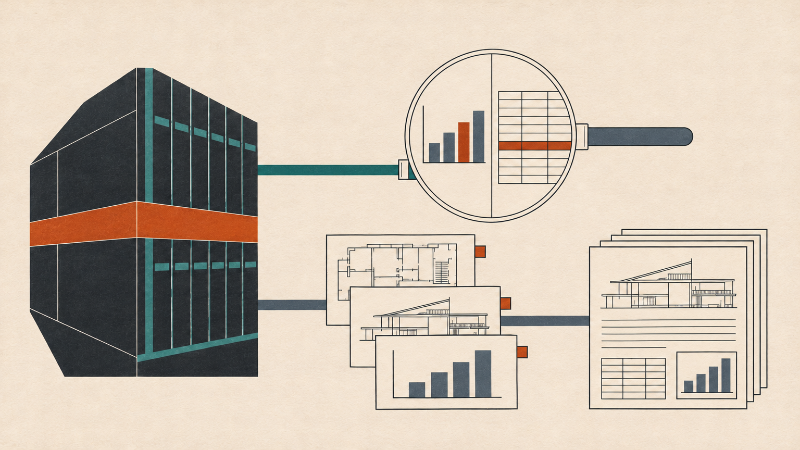

# MCP serving, `prepare_draft`, and cost scaling

`arkive-rag serve` mounts one or more `.arkive.db` snapshots read-only and exposes ten MCP tools over `stdio` (default) or `streamable-http`. The server performs zero generative LLM calls at runtime: it serves local SQLite indexes, bounded Markdown/WebP payloads, and (when `OPENAI_API_KEY` is set) a single query embedding per `search` or `prepare_draft` call.

## Startup verification and transport safety

When `TopicSnapshot.open` opens each `.arkive.db` file via a percent-encoded read-only SQLite URI (`?mode=ro`), it verifies:

- `SCHEMA_VERSION == "6.0"` and every required table is present;
- no dangling foreign keys exist and every facet value owns its canonical alias;
- `corpus_fingerprint`, every glossary citation, document roles, version families, feedback lessons, and recurring clusters pass structural validation;
- the normalised `(N, 1536)` `float32` chunk embedding matrix loads cleanly into memory.

The server starts even when `OPENAI_API_KEY` is absent. In offline mode, nine tools work unchanged (`prepare_draft` falls back to BM25 ranking) and only `search` reports that an API key is needed for dense embeddings. With `--transport streamable-http`, the server binds to `127.0.0.1:8000` by default and refuses non-loopback hosts unless `--allow-nonlocal` is passed explicitly because the HTTP transport has no built-in authentication.

## The ten MCP tools and output bounds

Every tool returns one compact JSON text block bounded to at most **45,000 bytes** and **1,600 lines** (`RESPONSE_MAX_BYTES`, `RESPONSE_MAX_LINES`). That cap sits below the threshold where MCP clients such as OpenCode truncate tool results, so agents never silently lose the tail of a search result, outline, or drafting packet.

When the server serves a single topic, `server_instructions` appends the topic's slug, facet names, and up to 20 deliverable types directly to the MCP initialise instructions so agents can skip a Turn-1 `list_topics` round-trip.

| Tool | Purpose | Default bounds and pagination |
| --- | --- | --- |
| `list_topics` | List served topics with their facets, allowed values, and deliverable types. | First 50 values/types per topic inline; counts the rest; paginated. |
| `get_topic_guide` | Return the cited Markdown guide, curator notes, facet definitions, glossary terms, and deliverable type counts. | Bounded to 45 KB; reports any omitted items explicitly. |
| `list_documents` | Browse documents with dates, deliverable types, version families, and bound facets. | Up to 100 docs per page (`offset`/`limit`); summaries clipped to `240` chars (`LIST_SUMMARY_CHARS`). |
| `get_document_outline` | Return a document's section tree (`section_id`, `heading_path`, page span, char count). | Paginated with `offset` when a long document outline exceeds one tool result. |
| `lookup_glossary` | List glossary terms or return matching entries with cited senses (`null` definition means unestablished from cited evidence). | Query capped at 1,000 chars; paginated within 45 KB. |
| `grep` | Case-insensitive, NFKC- and dash-normalised substring scan across section Markdown for exact codes, filenames, and numbers. | Default `max_matches=12` (hard cap 50); supports `filters`. |
| `search` | Hybrid FTS5 BM25 + L2 cosine similarity merged with Reciprocal Rank Fusion (`1 / (60 + rank)`). | Default `top_k=5` (hard cap 50); excludes superseded drafts behind their latest version; caps each version family at 3 chunks before backfilling. |
| `read_section` | Read full section Markdown with `prev_section_id` and `next_section_id` links. | Paginated with `offset` for sections exceeding one tool result. |
| `view_page` | Return a rendered `image/webp` page plus its visual summary and native text so multimodal models inspect charts, maps, and tables directly. | Text fields clipped with omitted counts if needed to fit 45 KB. |
| `prepare_draft` | Assemble a single bounded drafting packet for a new deliverable from the user's inputs. | Hard 45,000-byte budget; up to 3 exemplars + outlines + inline prose + lessons + notes + provenance. |

`list_documents`, `search`, `grep`, and `prepare_draft` accept `filters` (for example, `{"project": "Q102 Oskary Quarry", "document_role": "technical memorandum"}`). Canonical values and induced aliases both resolve; multiple facets combine with AND; an unknown facet or value returns a structured error listing the valid options so the agent can recover in one turn.

[Open interactive HTML diagram](assets/mcp-serving-and-drafting.html)

## Inside `prepare_draft`: how Arkive drafts at scale

Early versions of Arkive pre-compiled static deliverable "blueprints" at build time and forbade the agent from reusing wording outside a rigid whitelist. That approach broke down on large corpora (capping deliverable types, dropping domain explanations, and forcing agents to burn dozens of `read_section` turns).

Schema `6.0` replaces static blueprints with `prepare_draft(topic, project_inputs, deliverable_type, filters)`, which selects and packs the right reference material at request time:

1. **Task-ranked exemplar selection:** `prepare_draft` scores eligible latest-version deliverables against `project_inputs` using each document's best three chunk matches (hybrid BM25 + cosine when a key is present, BM25 alone offline). It admits up to **3 exemplars** (`MAX_PACKET_EXEMPLARS = 3`) and lists up to **8** `other_candidates`.
2. **Related-type backfill guard:** When fewer than two exemplars exist for the requested `deliverable_type`, a high-relevance sibling type can fill an open slot. Once two or more same-type exemplars are present, a third cross-type document is admitted only if its `deliverable_type` shares a content word with the requested type (for example, `Noise assessment letter` alongside `Noise assessment report`, not `Survey proposal` inside a `Technical memorandum`) and scores at least `0.6` (`CROSS_TYPE_RELEVANCE`) of the top exemplar.
3. **Fairness for 50+ page exemplars:** A single 52-page report with 86 sections could otherwise consume the entire 45 KB packet with its outline alone. Arkive caps each exemplar's initial outline at **8,000 bytes** (`EXEMPLAR_OUTLINE_MAX_BYTES`, preserving top-level, recurring, input-matched, and boundary rows first while reporting `omitted_outline_sections`) and reserves at least **16,000 bytes** (`PACKET_MIN_INLINE_BYTES`) for inline section Markdown before retaining a third exemplar's outline.
4. **Priority section packing:** Within the inline prose budget, `prepare_draft` packs whole sections in priority order: input-matched sections, sections holding distinct recurring clusters across exemplars, and opening/closing structural sections. It also surfaces up to **2** `supplemental_sections` from outside the chosen exemplars when they match rare terms in `project_inputs` (such as a specialist biography or method appendix).
5. **Curator notes and verified lessons:** Up to 6,000 bytes each of relevant `AGENTS.md` curator notes and verified `feedback_lessons` targeting the requested deliverable type ride directly in the packet, with `omitted_curator_notes` and `omitted_lessons` counted explicitly.
6. **Recurrence is evidence, not permission:** Rather than enforcing a hard `N >= 2` reuse gate, every section reports its provenance: document date, version status, and how many independent version families share its recurring text (`recurring_unit_families`, plus sample passages). Established multi-family methodology and caveats can be reproduced verbatim; single-family clauses or policies are flagged by their count so the calling agent can weigh applicability or ask the user. Every fact, number, date, and deliverable of the new work still comes strictly from `project_inputs`.

## Hosted models, costs, and scaling

Arkive fixes three OpenAI models in `src/arkive_rag/llm.py` and records the exact model IDs and reasoning efforts inside every snapshot's `corpus_meta.build_settings`:

| Model | Standard list price (in / cached / out per 1M tokens) | Used during `build` | Used during `serve` |
| --- | --- | --- | --- |
| `gpt-6.1-sol` | `$2.00` / `$0.10` / `$10.00` | Page vision transcription (low effort, high on retry), observation cards, corpus organisation, type canonicalisation, feedback lessons, glossary, topic guide | Never called by the MCP server (only by the client agent you choose) |
| `gpt-6-luna` | `$0.10` / `$0.01` / `$0.00` | Decisions API: content-bound facets, version-family confirmation/ordering, glossary & lesson support verification | Never called |
| `text-embedding-3-large` | `$0.13` / — / — | Batched chunk embeddings (1,536 dimensions) | One short query embedding per `search` or `prepare_draft` call |

### Measured build and runtime scaling (public fictional corpora)

- **Cold build cost scales with rendered pages, not corpus complexity:** Building the 126-file `structural-monitoring-consultancy` archive (110 Markdown files, 10 `.docx`, 6 `.pdf`, 110 rendered pages including a 52-page report, 1,086 chunks, 28 deliverable types, 29 lessons) cost roughly **$1.22** total across initial build + guide pass.
- **Unchanged cached rebuilds cost `$0.0000`:** Rebuilding the 126-file collection with `--cache` made **0 provider calls** and rendered **0 pages**.
- **Incremental file insertion:** Adding a 127th Markdown file to the 126-file archive preserved **126/126** existing document IDs, reused all cached renders and page transcriptions, and cost **$0.28** for reading the new file plus re-running corpus induction.
- **Runtime serving cost stays bounded as corpora grow:** Because every MCP tool result is capped at 45 KB / 1,600 lines and `prepare_draft` returns a single compact packet, runtime agent token usage grows slowly with archive size. On the 126-file engineering archive, Arkive MCP used **42% fewer input tokens** than raw file browsing on Q&A (`77,215` vs `134,043`) and **38% to 67% fewer input tokens** than raw files and full-context exemplars on the 52-page installation report holdout (`179,051` vs `287,143` raw files and `540,990` full-context).

Every paid CLI command (`arkive-rag build`, `python -m evals.run`) accepts `--max-cost <USD>`, blocking new provider attempts once estimated spend reaches the limit (in-flight calls can complete past the limit, and estimates exclude long-context surcharges).
