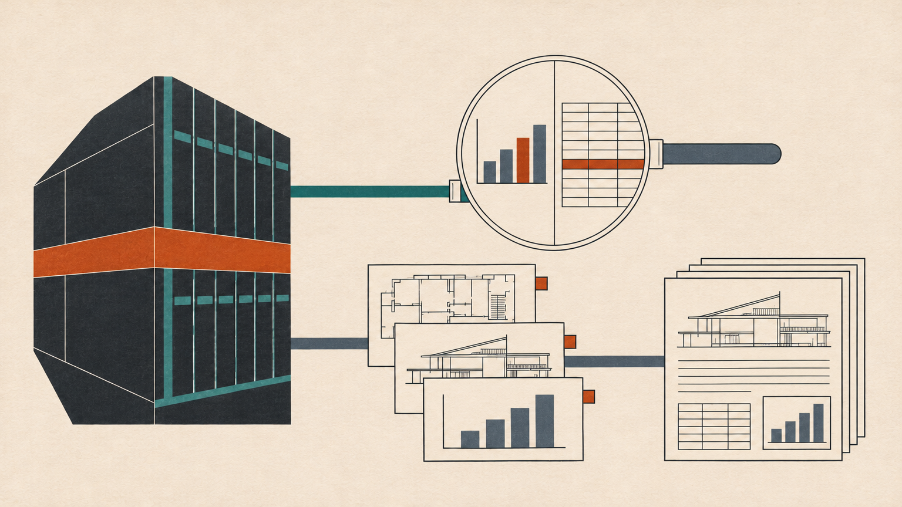

# Arkive overview and team workflows

Arkive RAG turns a folder of a team's best reference documents into one knowledge file, called a snapshot, that AI assistants can search, quote and draft from. The snapshot holds the text, tables, chart values and page images of every document. It also records how the documents relate: which are drafts and which are final, which are reviewer feedback, and which wording the team reuses on every job.

[Open the interactive diagram](assets/team-workflow.html)

## Problems with raw folders and generic AI chat

An AI assistant struggles with a shared drive of past reports for four reasons:

- **Documents are large.** A 50-page Word report or a slide deck does not fit comfortably in one prompt, so the assistant reads only part of it or reads it many times.
- **Values hide in images.** A chart legend or a map label often exists only as pixels, and plain text extraction misses it.
- **Old drafts sit beside final versions.** An assistant that reads a v0.8 draft can quote a number that the issued v1.0 report corrected.
- **Past projects leak into new work.** An assistant that copies from a complete old report can carry over that project's client name, site details or a one-off contract clause.

## Preparing a collection

A team lead collects the documents that show good work on one topic, typically 10 to 200 files. Arkive reads PDF (`.pdf`), Word (`.docx`), PowerPoint (`.pptx`), Excel (`.xlsx`), HTML (`.html`, `.htm`) and Markdown (`.md`) files. Legacy `.doc`, `.ppt` and `.xls` files need converting first, because the build stops when it finds an unsupported file type. Any folder layout works: one folder per project, per client or per author, or one flat folder. Nobody has to tag, rename or reformat a file in a supported format.

Arkive also reads content that does not show on the printed page. From Word files it keeps the accepted text of tracked changes and the reviewers' comments. From PowerPoint files it keeps speaker notes, comments and the numbers behind native charts.

The lead can add plain-English notes in files named `AGENTS.md` anywhere in the folder. A note can say how the collection is organised, which documents are missing, or how to use the examples. Arkive treats these notes as guidance and passes them to the assistant.

An engineer then runs one build command. The result is a single snapshot file, which the team can copy, keep beside snapshots of other topics, and rebuild when the folder changes.

## Two everyday workflows

**Pinpoint questions with citations.** Someone asks a factual question, such as which calibration certificate an instrument has or the minimum depth of a survey. The assistant searches the snapshot and narrows the search by project, client or kind of deliverable when the question names one. It answers with the document and section, and with page numbers when the document has pages. When a value sits in a chart, the assistant can open the rendered page image and read it. When the answer is spread over table rows in many documents, such as every alarm level in every installation report, the assistant reads the matching rows directly instead of opening each document.

By default, search leaves out documents that a later version replaces, so a question about the current fee is answered from the latest version. This rule only selects which versions to search. It does not prove that the latest version's figure is correct. For a question about how the fee changed between drafts, the assistant asks for every version and compares them.

**Drafting from past work.** Someone asks for a new deliverable, such as a proposal or an installation report, and supplies the new project's facts. Arkive returns a drafting packet that holds:

- up to three past deliverables with their outlines and key sections. Arkive prefers the requested kind and can include other relevant types when matching examples are scarce;
- the reviewer lessons that apply to that kind of deliverable;
- the team's `AGENTS.md` notes;
- samples of recurring wording and, for each section with recurring text, a count for its largest group of similar passages. The count is of deliverables, with all versions of one deliverable counted once. Passages in a group can differ. The count helps the assistant judge what may be standard wording.

The assistant takes project-specific facts, such as the client, site, dates, measurements and fees, from the supplied project facts. House-wide methods, equipment and standard values that recur identically across independent version groups, or that appear in the reviewer lessons, carry into the draft unless the project facts give a different value, which then wins. The draft follows the structure and house wording of the past examples.

## Example: a structural monitoring archive

The fictional collection `structural-monitoring-consultancy`, tracked in this repository, holds 126 files from an instrumentation consultancy: proposals, installation reports, drafts, QA checklists, calibration sheets and rate cards for five clients from 2023 to 2026.

One file is the 52-page Word installation and baseline report for the Askern Viaduct job. Arkive reads all 52 pages and splits the report into 86 sections. It labels the file an installation and baseline report, dated 14 October 2024, for the archived Askern Viaduct project. It records 17 facts that the report states about itself, such as its reference `MI-IR-2409` and the interrogator serial `PF4-1876`, and links each fact to the section that states it. It also stores the report's 61 tables so that an assistant can read their rows directly.

The same build finds that a calibration sheet for one interrogator was copied into two job folders. Arkive groups the two copies as versions of one document and marks one copy as superseded, so search shows only the other.

In another job folder, an unlabelled QA register holds reviewer comments. From it Arkive extracts a lesson for installation reports: apply temperature compensation with the strain-free reference gratings before reporting wavelength shifts as strain, and state this step in the method. When an assistant later drafts an installation report, this lesson arrives in its drafting packet.

## Further reading

- [Building and serving a snapshot](how-it-works.md) describes the build and what the server offers an assistant.
- [Data boundaries, security, and cost](security-privacy-and-cost.md) says what leaves your environment and what a build costs.
- [Test results and known limits](results-and-limits.md) gives the test results and where Arkive does not help.
