# Parsing, induction, and build pipeline

`arkive-rag build` turns an arbitrary folder of `.pdf`, `.docx`, `.pptx`, and `.md` documents into a single read-only SQLite snapshot (`*.arkive.db`, schema `6.0`). The compiler makes no assumptions about folder hierarchy, domain vocabulary, or heading conventions: a flat directory of Word and PDF files compiles through the same three-pass pipeline as a 126-file multi-client engineering archive.



[Open interactive HTML diagram](assets/build-pipeline.html)

## Pass 1: per-document reading (`compiler.py`)

Pass 1 processes each source file independently in a thread pool and produces a `DocumentReading` determined strictly by the file's bytes and format (the relative path is carried only for diagnostics).

### Discovery, path-hash IDs, and document dates

`discover_corpus` walks the corpus in sorted POSIX relative-path order, rejects symlinks and unsupported file extensions before making any model call, and hashes each file's bytes with SHA-256.

- **Stable document IDs:** `document_id(rel_path)` hashes the NFC-normalised POSIX path to produce `doc_<10hex>` (for example, `q102-oskary-quarry/q102-technical-memorandum.pdf` becomes `doc_cc01ac49e1`). Adding or moving another file in the folder never renumbers existing documents, while SQLite queries preserve deterministic sorted-path ordering via an `ordinal` column.
- **Document dates:** Arkive extracts a validated `DocumentDate` (`iso` and `basis`) from two sources. Printed dates come from the document's observed text (`basis: "printed"`). When a file has no printed date, the compiler inspects embedded PDF metadata (`/CreationDate`, `/ModDate`) or Office XML `docProps/core.xml` properties (`basis: "metadata"`). In the flat `acoustic-consultancy-files` collection, where files carry no printed dates and no folder structure, `corvane-depot-night-noise-report.pdf` (`doc_d81e70766d`) still receives `iso="2025-06-30", basis="metadata"`.
- **Curator notes:** Any `AGENTS.md` file anywhere in the corpus is marked `is_curator_note = True` and read directly without a model call. Curator notes steer corpus induction and appear in `get_topic_guide` and `prepare_draft`, but the induced guide, glossary, and feedback lessons never cite them.

### Office conversion, rendering, and the render cache

Word (`.docx`) and PowerPoint (`.pptx`) files are converted to PDF in an isolated headless LibreOffice (`soffice`) temporary directory so checkboxes, floating text boxes, embedded charts, and slide layouts go through the exact same page pipeline as native PDFs.

`pypdfium2` extracts each page's Unicode native text layer and renders a 2x WebP image (`webp_bytes`, clamped to `MAX_RENDER_SIDE_PX = 4096`). When `--cache` is supplied, `BuildCache` stores rendered pages and metadata dates in SQLite (`page_render_cache` and `page_render_meta`) keyed by source SHA-256 and checks the cache before invoking LibreOffice or `pypdfium2`. Rebuilding an unchanged corpus renders zero pages.

### Vision transcription, fidelity checks, and section stitching

For each rendered page, `transcribe_with_fidelity` sends `gpt-6.1-sol` (low reasoning effort) three inputs: the 2x WebP page image, the extracted native text layer, and the last 1,200 characters of the preceding page's transcribed blocks (excluding visual transcripts). The model returns structured blocks (headings, paragraphs, tables, lists) plus separate `VisualTranscript` blocks for charts, maps, and diagrams.

Two mechanical checks guard transcription quality:

1. **Numeric and filename fidelity:** The compiler extracts anchor tokens (numbers, measurements, filenames) from the native text layer and checks that they survive transcription. If a page drops anchors or hits a ligature corruption, Arkive retries that page once at high reasoning effort. If the retry changes the page's trailing 1,200-character tail, page `N + 1` re-transcribes; propagation stops as soon as a tail matches.
2. **Cross-page section and table stitching:** `assemble_sections` builds full Markdown sections with hierarchical `heading_path` strings and `page_start..page_end` spans. When a paragraph or Markdown table continues across a page break (`continues_from_previous_page=True`), Arkive joins it into one section; when a table row splits mid-cell across pages (`merges_into_previous_row=True`), it merges the split cells column by column while preserving row-level page provenance.

Sections exceeding `MAX_SECTION_CHARS = 32_000` split cleanly at paragraph or table boundaries without cutting inside fenced code blocks or visual transcripts. Each section is then split into `prose`, `table`, `visual`, or `guidance` chunk pieces capped at `MAX_CHUNK_CHARS = 6_000`.

### Per-document observation cards

Finally, `ObserveSections` asks `gpt-6.1-sol` (low effort, batched over long documents with one consolidation pass) to produce an observation card per citable document: title, printed date, proposed deliverable type, whether the document is reviewer feedback (and which types it reviews), summary, observed attributes, domain terms, and craft notes. Every quoted term or craft observation is matched back to an exact section via `fold_for_quote`; unlocated quotes are discarded and counted in `build_report.discarded_unlocated_quotes`.

## Pass 2: bounded corpus induction (`induction.py`)

Pass 2 reads the observation cards, folder paths, and curator notes to induce corpus-level structure. Every prompt in Pass 2 enforces a hard `MAX_PROMPT_CHARS = 90_000` ceiling (~30k tokens), so a 150-document archive never overflows context windows.

1. **Facets and uncapped deliverable types (`OrganiseCorpus`, `CanonicaliseTypes`):** Document digests are grouped into batches of at most 44,000 characters. The model proposes 0 to 6 corpus-specific filter facets (either `path`-bound from directory structure or `content`-bound from document text) and maps raw type labels into canonical deliverable types in one canonicalisation pass with no cap on how many types a corpus can have.
2. **Facet binding (`bind_facets`):** Path-bound facets assign values deterministically from folder segments. Content-bound facets are judged per citable document by `gpt-6-luna` on the Decisions API against the document's card and outline. Unused values and facets with fewer than two populated values are pruned and logged in `build_report`.
3. **Version families (`detect_version_families`):** Python proposes candidate pairs of documents that share high 4-gram text overlap or overlapping title/filename tokens within a type. `gpt-6-luna` confirms which pairs are drafts, revisions, or exports of the same deliverable. Validated dates (or `gpt-6-luna` when dates tie or are absent) mark one member `latest` and older members `superseded`, or `unordered` when evidence cannot order them.
4. **Verified feedback lessons (`ExtractFeedbackLessons`):** For each feedback document, `gpt-6.1-sol` extracts transferable reviewer lessons with verbatim quotes; Python locates each quote to a section, and `gpt-6-luna` confirms whether each lesson is supported by that section's text. Unconfirmed lessons are dropped and recorded in `build_report.dropped_feedback_lessons`.
5. **Cited glossary (`WriteGlossary`):** Observed terms and occurrences produce cited senses. `gpt-6-luna` verifies every proposed definition against its cited evidence; unsupported definitions are demoted to `null` (recorded in `build_report.unsupported_definitions`) rather than allowing invented definitions into the snapshot.
6. **Recurring text units (`passages.py`):** Pure Python extracts normalised prose units, list items, and table header rows from every citable document, indexes their word 4-grams, and clusters units shared across multiple documents into `unit_clusters` and `cluster_sections` (retaining each holder's matched sample text). No LLM call is used here.
7. **Bounded topic guide (`WriteGuide`):** `gpt-6.1-sol` synthesises a 4,000 to 8,000 character thematic overview (hard ceiling 16,000 characters / 24,000 JSON bytes) from a bounded catalog of documents, facets, types, glossary terms, and curator notes. Python verifies that every `[doc_id:section_id]` citation points to a real citable section.

## Pass 3: breadcrumbs, embeddings, and atomic snapshot (`snapshot.py`)

Pass 3 binds each section and chunk to its final IDs (`<doc_id>_sec_001`, `<doc_id>_chk_0001`), prepends a metadata breadcrumb to every chunk containing its bound facets, document title, page span, and heading path, and embeds `breadcrumb + "\n" + content` in batches with `text-embedding-3-large` (1,536 dimensions, L2-normalised `float32`).

`write_snapshot` populates a temporary sibling SQLite file (mode `0600`) in one transaction, builds the SQLite FTS5 index (`chunks_fts`, weighting NFKC-normalised content 10x and breadcrumbs 2x), runs foreign-key and integrity checks, and atomically renames the file into place.

## Worked example from a public corpus

To see what these three passes produce on a real multi-format file, inspect `archive/m2409-northbray-askern-viaduct/m2409-installation-and-baseline-report.docx` inside the 126-file fictional `structural-monitoring-consultancy` collection:

1. **Discovery and identity:** `document_id` hashes the path to `doc_4957546a24`. LibreOffice converts the Word file to PDF, and `pypdfium2` renders all **52 pages** to cached 2x WebP images.
2. **Transcription and assembly:** Vision transcription + cross-page stitching produces **86 sections** (`doc_4957546a24_sec_001` through `doc_4957546a24_sec_086`), preserving document-control tables and multi-page instrument schedules.
3. **Induction:** Across the 126-file collection, induction creates **28 canonical deliverable types**, **29 verified reviewer lessons**, and a **9,724-character** cited topic guide. For `doc_4957546a24`, it assigns:
   - `deliverable_type`: `Installation and baseline report`
   - `doc_date`: `14 October 2024`
   - `version_status`: `sole` (meanwhile, a calibration file in the same project folder, `doc_a971f575a6`, is automatically marked `superseded` by `doc_fed78f012b`)
   - Bound facets: `job_status: archived`, `project: M2409 — Askern Viaduct`, `sensing_technology: fibre_bragg_grating`, `monitoring_technology: Fibre Bragg grating`
4. **Stored chunk breadcrumb:** Chunk `doc_4957546a24_chk_0001` (`kind="table"`, pages 1-1) is indexed and embedded as:

```text
[job_status: archived | sensing_technology: fibre_bragg_grating | project: M2409 — Askern Viaduct | monitoring_technology: Fibre Bragg grating | Doc: Askern Viaduct: fibre Bragg grating installation and baseline report (pp. 1-1) | Section: Askern Viaduct: fibre Bragg grating installation and baseline report]
| Item | Detail |
| --- | --- |
| Our ref | MI-IR-2409 |
| Client | Northbray Rail Infrastructure |
| Client contact | Mr Jarrow Keld |
| Author | Maren Lisk |
```

5. **Linked reviewer lesson:** Separately, from an unlabelled QA register (`doc_4329fae0a3`), Pass 2 extracts and verifies a transferable lesson targeting `Installation and baseline report`: *"Explain that strain is calculated only after subtracting the strain-free reference grating response for temperature compensation."*

When the same 126-file collection is rebuilt with `--cache` and no files changed, Arkive makes **0 provider calls** (`$0.0000`). When a 127th file (`a00-new-intake/a00-scoping-note.md`) is inserted at the start of the directory tree, all **126/126** existing `doc_id` values remain unchanged.
