# Test results and known limits

On a 126-file engineering archive, the current version of Arkive grouped all 5 multi-version documents correctly, and picked the right latest version for the 4 that have one, in three independent runs of its collection-organising step. It answered every current-value and version-history question correctly, and answered both questions that span many reports correctly in every run. For a long installation report, its drafts passed every rubric check and beat the raw files and plain chunk search in all 5 blind-judge rounds. Pasting the complete past reports into the prompt still produced the best long-report draft, at a similar token cost.

## Test method

All tests used fictional documents. The main tests used the four collections tracked in this repository, which range from 9 files to a 126-file archive of Markdown, Word and PDF files with drafts, duplicates and a 52-page report. Three small synthetic collections tested hard cases: version traps, a 60-document table rollup, and deliberately messy Office, HTML and PDF files. These three collections, and the extra question and drafting sets used for the current version, are kept outside the repository. Only the four tracked collections and their question sets can be rerun from it.

Each test gave the same AI model, `gpt-6.1-sol`, the same task with different tools:

- **Arkive:** the eleven Arkive tools over a snapshot of the collection. A snapshot is the single knowledge file that `arkive-rag build` makes from a document folder. The assistant calls the tools over MCP (Model Context Protocol), a standard way for an AI assistant to use tools that another program provides.
- **Raw files:** tools to list, search, read and view the original files directly.
- **Chunk search:** a plain search over text fragments, used in drafting tests.
- **Pasted examples:** hand-picked complete reference documents placed straight into the prompt. This is the control that the other approaches are compared against.

Answers were scored by phrase checks and by a separate model acting as a blind judge, which did not know which approach produced each answer. Most questions ran 3 times. The chart questions on the three small collections ran once. Each drafting test held one real document out of the collection, asked each approach to write it again from project notes, and compared the drafts with the held-out original over 5 rounds. A final check ran 13 scenarios in a real MCP client, OpenCode 2.3.0, inside fresh Docker containers.

The results below are for the current version. [Appendix C](appendices/evaluation-benchmarks.md) gives every number, with the previous version's results as the baseline.

## Main results

**1. Drafts are kept apart from issued versions.** In three independent runs of the collection-organising step on the 126-file archive (one during a full first build and two that reused its cached document readings), Arkive grouped all 5 multi-version documents exactly and named the right latest version in all 4 cases where one exists. It made no wrong groupings. In the version-trap collection it kept an addendum, two project phases and two monthly bulletins apart from each other. It also chose the issued final over a draft whose file was saved later.

**2. Current values and version history are both answered correctly.** On questions about current values, such as alarm levels and a fee, and about how those values changed between drafts, Arkive passed 12 of 12 runs. It never quoted a superseded value as current, scored 5.00 out of 5 for accuracy, and made no contradicted claims. Current-value answers used about half the input tokens of the raw-file approach.

**3. Questions that span many reports are answered correctly, with uneven token use.** Two questions each needed facts from many reports. The assistant answered them by listing the documents of one kind, then reading their recorded facts and sections, and in some runs by querying stored tables.

- **All 18 issued installation reports.** Counting and summarising them used a median of 97,600 input tokens over 3 runs. That is 73.6% less than the 369,800 used in one run on the previous version, and slightly below the raw-file median of 102,700. The averages point the other way, 177,000 for Arkive against 98,400 for raw files, because one Arkive run used 358,800.
- **Four projects' interrogators and alarm levels.** Listing them used 40,600 input tokens on average against 90,200 for raw files, with higher accuracy (5.00 against 4.00).

Across all 7 questions in this set, total input tokens were close: 793,000 for Arkive and 774,000 for raw files. On a 60-document synthetic collection whose values sit only in tables, Arkive queried tables across the collection and answered all 6 table rollup runs correctly.

**4. Long-report drafts now apply the house method.** For a new installation report modelled on the archive's 52-page report, Arkive's drafts passed 60 of 60 rubric checks, up from 55 of 60 on the previous version. The check for the house temperature-compensation step went from 0 of 5 rounds to 5 of 5. Median house-text recall rose from 0.656 to 0.800, and median copied-text contamination was 0.0011. Both scores measure wording overlap. The contamination score excludes wording found in the target report, the project notes or the test's task instructions. [Appendix C](appendices/evaluation-benchmarks.md#kinds-of-test) explains both measures. Arkive ranked second behind the pasted examples in every round and ahead of raw files and chunk search in all 5. In a variant where the project notes gave a different batch calibration value, all 5 Arkive drafts used the project value.

**5. Standard wording is reused without borrowed site values.** For a night-noise report in the acoustic consultancy collection, house-wording recall rose from 0.343 to 0.759. Arkive won 4 of 5 blind-judge rounds, and no draft borrowed another site's values.

**6. Charts, new formats and a real client all worked.** Arkive found and answered all 4 values that appear only in charts across the four collections. On five deliberately messy files (a workbook, an HTML page, a Word file with tracked changes and comments, a deck with notes and a native chart, and a PDF with compound units), every check of the stored content passed. Arkive answered 14 of 15 question runs correctly against 9 of 15 for raw files. All 13 live OpenCode scenarios passed, with no cut-off result and no call to a tool outside Arkive.

## Previous-version baseline

The diagram below shows results from the previous version (snapshot format schema 6.0) only: input tokens for questions and long-report drafting on the 126-file archive, and the judge's discipline score for a drafting task in which the pasted examples borrowed another project's retention policy.

[Open the interactive baseline diagram](assets/benchmark-highlights.html)

## Good fits and measured limits

Arkive helps most when a collection is large, mixes formats, holds drafts beside final versions, keeps values in tables across many documents, or carries one-off clauses that must not spread to new work.

The tests measured these limits:

- **Small collections.** Under about 10 short Markdown files, pasting two or three files into the prompt uses fewer tokens than the overhead of the MCP tools. On the 60-document table collection, raw files also answered every question, with fewer input tokens, because the matching rows were few enough to find with one text search.
- **Very long reports.** Pasting the full 52-page report still won every blind-judge round for the long installation report. To reach its rubric score, the Arkive assistant read many extra sections and used about 495,000 input tokens over 5 rounds. That is close to the 541,000 used with pasted examples and more than the 298,000 used with raw files.
- **Filters can differ between builds.** Arkive organises a large collection in batches. In two of the three organising runs on the 126-file archive, the project filter listed only the jobs from one batch, covering 23 of 124 documents. The third run covered 110. An assistant that asks for a project the filter lacks gets the list of valid values and can retry.
- **Broad table queries.** A table query that mixes a column name with a value word, such as "Zone C Fail", also matches every table whose header contains "Zone". In two runs this returned 49 tables and raised input tokens about tenfold.
- **Reproduced method text.** In the night-noise report, Arkive reproduced the house survey-method text even though the project notes did not mention it. The judge marked this down for discipline (7 out of 10, against 10 on the previous version) and confirmed that no other site's details leaked.
- **Chart slides without a drawn chart.** In one of three runs on the messy deck, the slide image showed no drawn chart. The assistant viewed it and did not read the stored chart table in the same section.

## Full data

[Appendix C: Evaluation method and full results](appendices/evaluation-benchmarks.md) has every collection and drafting result, the before-and-after tables, the search tests, and the commands to run the evaluation yourself on the four tracked collections.
