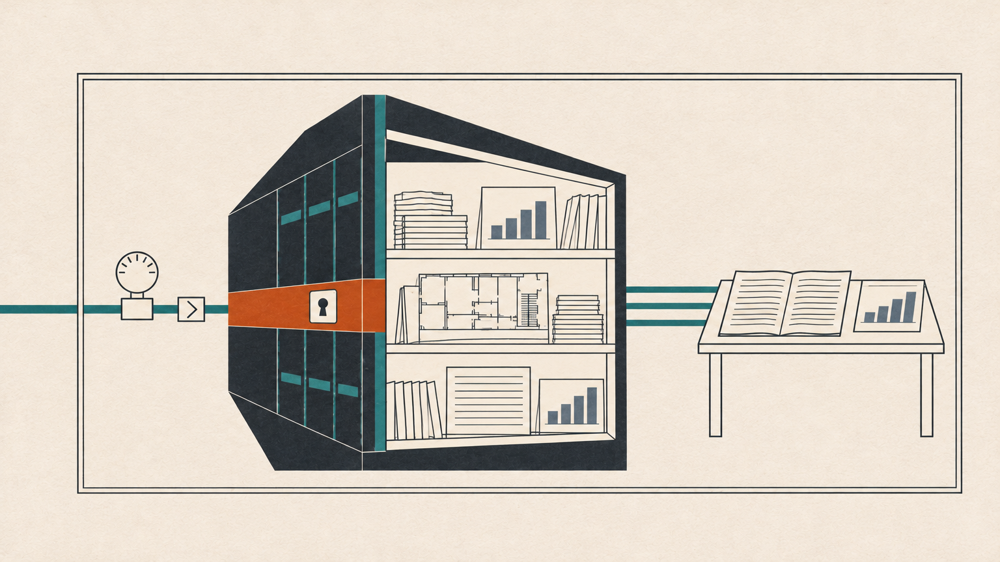

# Data boundaries, security, and cost

Arkive sends document content to OpenAI only while it builds a snapshot. After the build, the snapshot is a local file that the server reads without any generative AI calls. Every paid command takes a spending limit.

## What leaves your environment and when

[Open the interactive diagram](assets/data-and-trust-boundaries.html)

| Situation | Sent to OpenAI | Stays local |
| --- | --- | --- |
| **First build** | Page images and page text for transcription, document sections (including the text of Excel and HTML files) for summaries, folder names, curator notes, and document summaries for organising the collection, and chunk text for embeddings (numeric vectors used for meaning-based search). | Source files, rendered pages, and the finished snapshot. |
| **Unchanged rebuild with `--cache`** | Nothing. The cache answers every request, so the build makes zero provider calls. | Everything. |
| **Serving with an API key** | The text of each `search` query, and the project inputs given to `prepare_draft`, to turn them into embeddings. No document content is sent. | The snapshot and every tool result. |
| **Serving without an API key** | Nothing. Ten of the eleven tools work, and `search` reports that it needs a key. | Everything. |

The AI assistant that calls Arkive is a separate program. It sends the tool results it receives to whatever model it uses, under that assistant's own data terms.

## Operational safeguards

- **Read-only serving.** The server opens each snapshot in read-only mode and checks its structure and citations on startup. No tool can change a snapshot.
- **Owner-only files.** A new snapshot and a new build cache are created with file mode `0600`, so only the owning user can read them. Replacing an existing snapshot keeps that file's mode.
- **Symlinks rejected.** The build refuses symbolic links and files that resolve outside the corpus folder, before any model call.
- **Bounded Office files.** Before a Word, PowerPoint, or Excel file is opened, Arkive checks its compressed archive by unpacking it in small steps. It refuses an archive with too many entries, an encrypted or damaged entry, or one that would expand past a fixed size, so a small crafted file cannot expand into an unbounded amount of data. A workbook with more populated cells than a fixed limit is refused instead of being cut short. [Appendix A](appendices/build-and-parsing.md#office-conversion-rendering-and-the-render-cache) gives the limits.
- **No fetches from HTML.** An HTML page is read from its saved bytes only. Arkive fetches none of its images, from the network or from disk.
- **Outputs kept out of the corpus.** The build refuses to write a snapshot or cache inside the folder it reads.
- **Local-only HTTP by default.** Over HTTP (`--transport streamable-http`), the server binds to `127.0.0.1`. The HTTP transport has no built-in authentication, so serving on another host requires the explicit flag `--allow-nonlocal`.
- **Private data outside Git.** Keep client documents and snapshots in a private store. The repository's `.gitignore` excludes `*.arkive.db` snapshots and `*.eval.local.json` private evaluation packs.

## Cost profile and spend controls

Arkive uses three fixed OpenAI models: `gpt-6.1-sol` for reading pages, observing each document, deciding which documents are versions of one deliverable, and writing summaries; `gpt-6-luna` for yes/no checks; and `text-embedding-3-large` for search vectors. Version decisions use `gpt-6.1-sol` because a wrong latest version would hide the issued document from later answers. [Appendix B](appendices/mcp-tools-and-drafting.md#hosted-models-costs-and-scaling) lists the price per million tokens of each.

**Spending limit.** `arkive-rag build` and `python -m evals.run` take `--max-cost <USD>`. Once the estimated spend reaches the limit, no new paid call starts. Calls already in flight can finish past the limit, and the estimate does not include the long-context surcharge. Each build prints its calls, tokens, and estimated cost.

**Measured build costs** from metered builds of the tracked fictional collections:

| Build | Provider calls | Cost |
| --- | --- | --- |
| Cold build of all 126 files of `structural-monitoring-consultancy` (110 rendered pages, including a 52-page Word report) | 490 | $4.67 |
| Rebuild of the same archive with no changes, using `--cache` | 0 | $0.0000 |
| Cold build of a 9-file collection (`creator-campaigns`, `coastal-survey-projects`, `acoustic-consultancy-files`) | 31 to 42 | $0.18 to $0.37 |

Reading pages and observing each document account for most of the cost of the large archive, so build cost grows mainly with the number of rendered pages and the amount of document text. Adding one file to a cached build reads only that file and reruns the collection-level pass; on the previous pipeline this cost $0.28 for a 127th Markdown file.

**Runtime savings.** The server itself costs nothing to run beyond the optional query embeddings. Its effect on the assistant's own model bill comes from bounded results. On the 126-file archive, a question about a current value used about 5,000 input tokens with Arkive, about half of what the raw-file tools used, and a question about four projects' interrogators and alarm levels used 40,600 against 90,200. The savings vary by question: across all seven questions in that test set, Arkive and the raw-file tools used about the same total input tokens. Long drafting costs more: to match the house wording of a 52-page report, the assistant read many sections and used more input tokens than raw-file tools. [Evidence, benchmarks, and known limits](results-and-limits.md) gives the details.
